<!-- rendered by docs/build.mjs from docs/README.template.md: edit that, not this -->


# tumble

tumble is a 3D physics engine in C++, built for games and simulations. It comes with JavaScript bindings,
[tumble.js](https://github.com/isaac-mason/tumble/tree/main/js#readme).

**Features**

- rigid bodies, with sleeping, sensors and continuous collision detection
- spheres, boxes, capsules, cylinders, convex hulls, triangle meshes, planes and compounds, plus your own shape types
- constraints with motors and springs: hinge, slider, distance, point, fixed, cone, swing-twist and six-dof
- a character controller that walks up slopes and stairs, slides along walls and rides moving bodies
- ray, point, overlap, sweep and bounds queries, with collision filtering
- a step you can run phase by phase, reading, rejecting and changing its contacts in between
- contact pairs that track only the contacts you care about
- deterministic: the same steps give the same results natively and in WebAssembly, with or without SIMD
- C++20 with no dependencies: no standard library, no exceptions and no RTTI
- all memory through one allocator that you can replace
- the whole API from one include, `tumble/tumble.h`

**Single threaded**

tumble runs on one thread for now. It mainly targets WebAssembly, for deployment to game portals. WebAssembly threads need SharedArrayBuffer, which many portals do not support. Multithreading may come in the future.

**Samples**

`samples/` is an app of the C++ samples below, each one file in [`samples/examples/`](./samples/examples). Try them in
your browser at [isaac-mason.github.io/tumble/samples](https://isaac-mason.github.io/tumble/samples/). Each picture
opens its sample there, and "source" opens its code. The app also builds natively with `samples/native.sh`. The
[tumble.js examples](https://isaac-mason.github.io/tumble/examples/) show the JavaScript bindings.

<table>
  <tr>
    <td align="center">
      <a href="https://isaac-mason.github.io/tumble/samples/?example=example_shapes">
        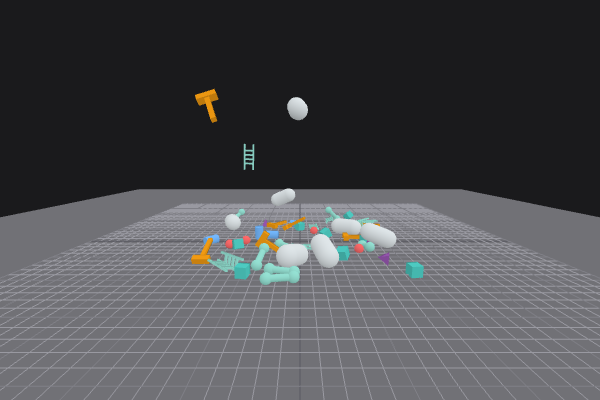<br/>
        Shapes
      </a><br/>
      <sub><a href="./samples/examples/example_shapes.cpp">source</a></sub>
    </td>
    <td align="center">
      <a href="https://isaac-mason.github.io/tumble/samples/?example=example_triangle_mesh">
        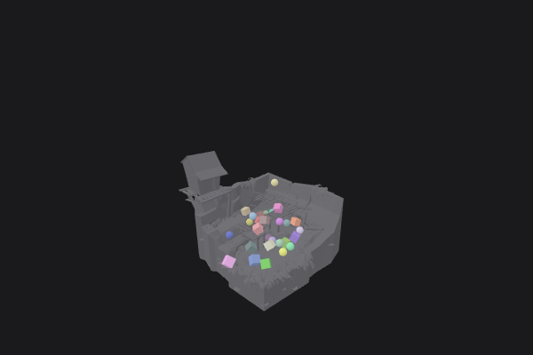<br/>
        Triangle Mesh
      </a><br/>
      <sub><a href="./samples/examples/example_triangle_mesh.cpp">source</a></sub>
    </td>
    <td align="center">
      <a href="https://isaac-mason.github.io/tumble/samples/?example=example_raycast_vehicle">
        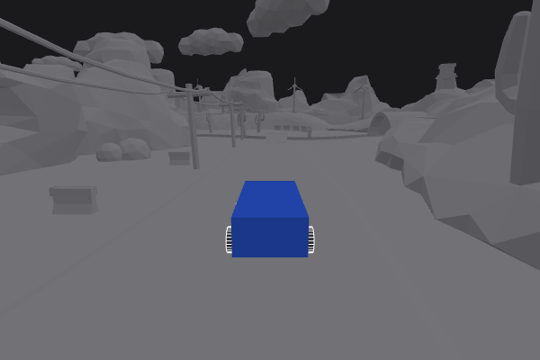<br/>
        Raycast Vehicle
      </a><br/>
      <sub><a href="./samples/examples/example_raycast_vehicle.cpp">source</a></sub>
    </td>
    <td align="center">
      <a href="https://isaac-mason.github.io/tumble/samples/?example=example_ragdoll">
        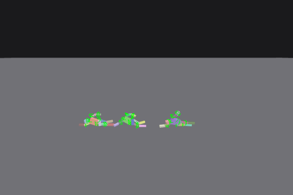<br/>
        Ragdoll
      </a><br/>
      <sub><a href="./samples/examples/example_ragdoll.cpp">source</a></sub>
    </td>
  </tr>
  <tr>
    <td align="center">
      <a href="https://isaac-mason.github.io/tumble/samples/?example=example_kinematic_character_controller">
        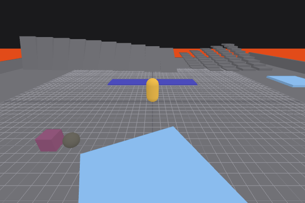<br/>
        Kinematic Character Controller
      </a><br/>
      <sub><a href="./samples/examples/example_kcc.cpp">source</a></sub>
    </td>
    <td align="center">
      <a href="https://isaac-mason.github.io/tumble/samples/?example=example_kcc_stress_test">
        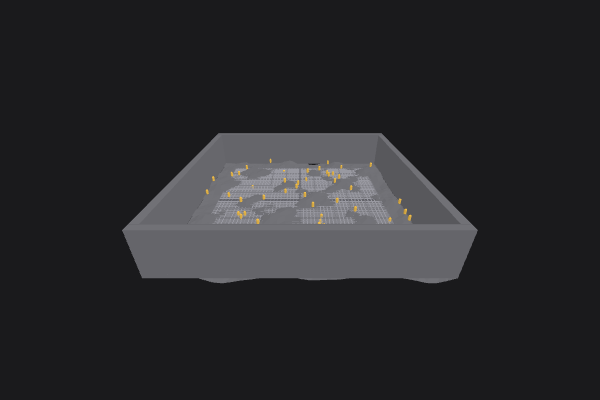<br/>
        KCC Stress Test
      </a><br/>
      <sub><a href="./samples/examples/example_kcc_stress_test.cpp">source</a></sub>
    </td>
    <td align="center">
      <a href="https://isaac-mason.github.io/tumble/samples/?example=example_floating_character_controller">
        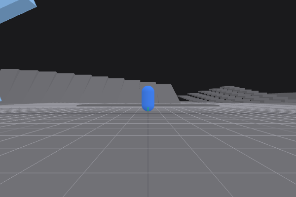<br/>
        Floating Character Controller
      </a><br/>
      <sub><a href="./samples/examples/example_floating_character_controller.cpp">source</a></sub>
    </td>
    <td align="center">
      <a href="https://isaac-mason.github.io/tumble/samples/?example=example_pointer_raycast">
        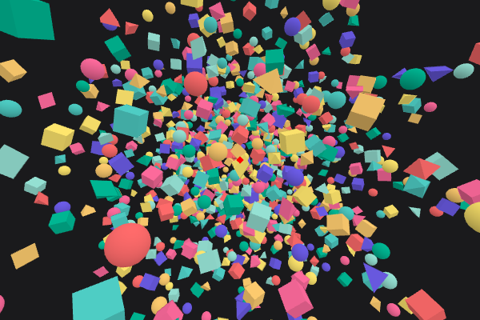<br/>
        Pointer Raycast
      </a><br/>
      <sub><a href="./samples/examples/example_pointer_ray.cpp">source</a></sub>
    </td>
  </tr>
  <tr>
    <td align="center">
      <a href="https://isaac-mason.github.io/tumble/samples/?example=example_cluster">
        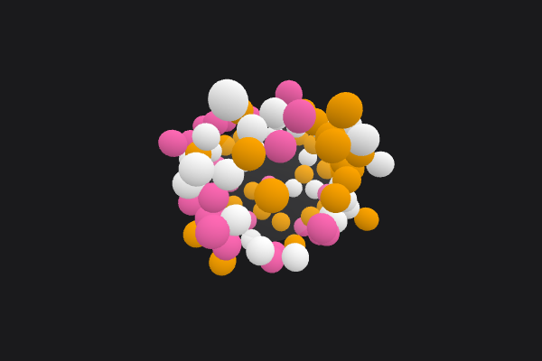<br/>
        Cluster
      </a><br/>
      <sub><a href="./samples/examples/example_cluster.cpp">source</a></sub>
    </td>
    <td align="center">
      <a href="https://isaac-mason.github.io/tumble/samples/?example=example_cube_heap">
        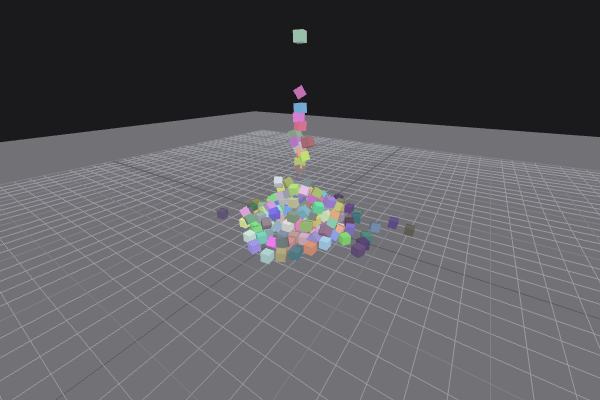<br/>
        Cube Heap
      </a><br/>
      <sub><a href="./samples/examples/example_cube_heap.cpp">source</a></sub>
    </td>
    <td align="center">
      <a href="https://isaac-mason.github.io/tumble/samples/?example=example_static_compound_shapes">
        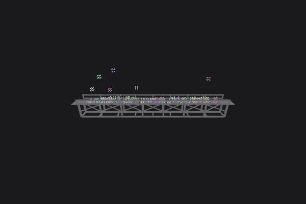<br/>
        Static Compound Shapes
      </a><br/>
      <sub><a href="./samples/examples/example_static_compound.cpp">source</a></sub>
    </td>
    <td align="center">
      <a href="https://isaac-mason.github.io/tumble/samples/?example=example_continuous_collision_detection">
        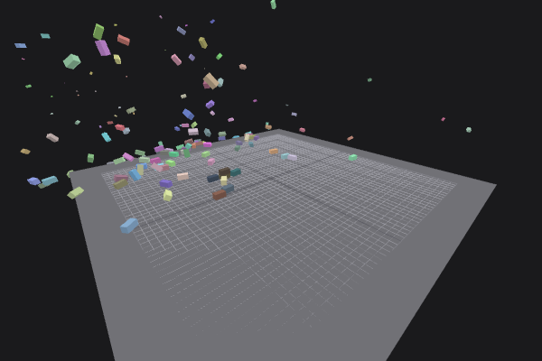<br/>
        Continuous Collision Detection
      </a><br/>
      <sub><a href="./samples/examples/example_ccd.cpp">source</a></sub>
    </td>
  </tr>
  <tr>
    <td align="center">
      <a href="https://isaac-mason.github.io/tumble/samples/?example=example_kinematic_body">
        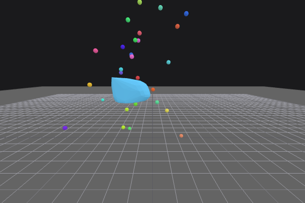<br/>
        Kinematic Body
      </a><br/>
      <sub><a href="./samples/examples/example_kinematic.cpp">source</a></sub>
    </td>
    <td align="center">
      <a href="https://isaac-mason.github.io/tumble/samples/?example=example_constraints">
        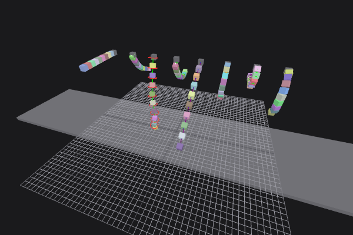<br/>
        Constraints
      </a><br/>
      <sub><a href="./samples/examples/example_constraints.cpp">source</a></sub>
    </td>
    <td align="center">
      <a href="https://isaac-mason.github.io/tumble/samples/?example=example_constraint_motors">
        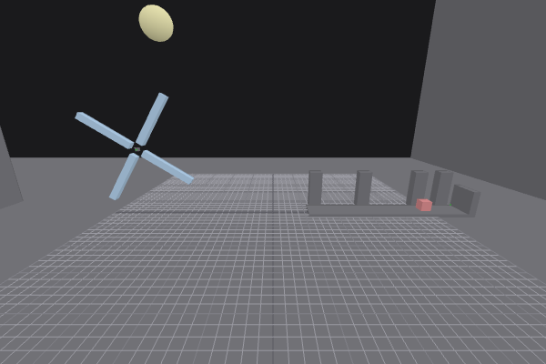<br/>
        Constraint Motors
      </a><br/>
      <sub><a href="./samples/examples/example_constraints_motors.cpp">source</a></sub>
    </td>
    <td align="center">
      <a href="https://isaac-mason.github.io/tumble/samples/?example=example_hinge_motor">
        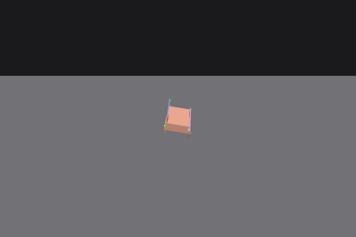<br/>
        Hinge Motor
      </a><br/>
      <sub><a href="./samples/examples/example_hinge_motor.cpp">source</a></sub>
    </td>
  </tr>
  <tr>
    <td align="center">
      <a href="https://isaac-mason.github.io/tumble/samples/?example=example_voxel_triangle_mesh">
        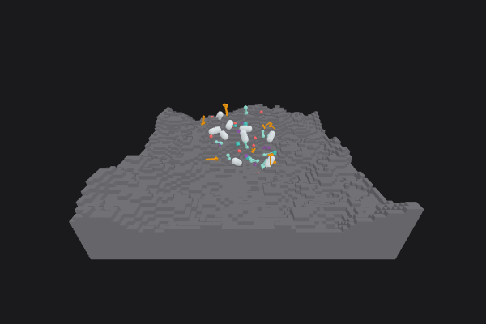<br/>
        Voxel Triangle Mesh
      </a><br/>
      <sub><a href="./samples/examples/example_voxel_triangle_mesh.cpp">source</a></sub>
    </td>
    <td align="center">
      <a href="https://isaac-mason.github.io/tumble/samples/?example=example_voxel_custom_shape">
        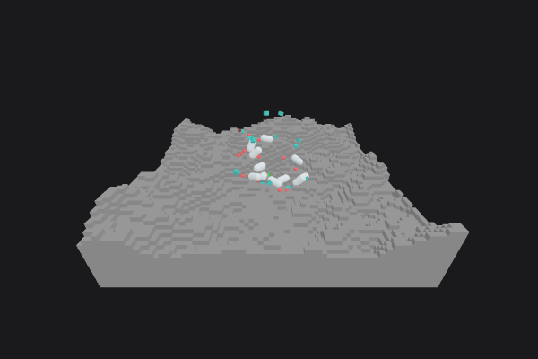<br/>
        Voxel Custom Shape
      </a><br/>
      <sub><a href="./samples/examples/example_voxel_custom_shape.cpp">source</a></sub>
    </td>
    <td align="center">
      <a href="https://isaac-mason.github.io/tumble/samples/?example=example_restitution">
        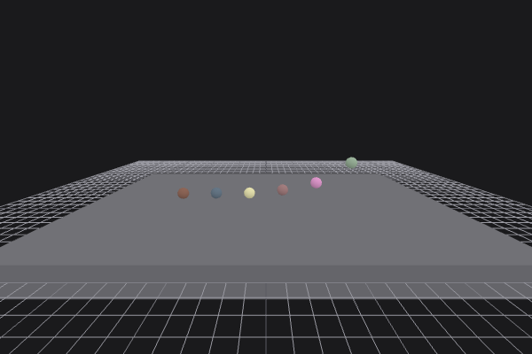<br/>
        Restitution
      </a><br/>
      <sub><a href="./samples/examples/example_restitution.cpp">source</a></sub>
    </td>
    <td align="center">
      <a href="https://isaac-mason.github.io/tumble/samples/?example=example_friction">
        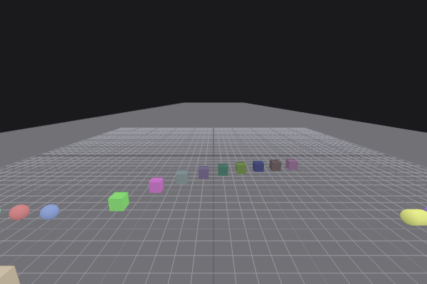<br/>
        Friction
      </a><br/>
      <sub><a href="./samples/examples/example_friction.cpp">source</a></sub>
    </td>
  </tr>
  <tr>
    <td align="center">
      <a href="https://isaac-mason.github.io/tumble/samples/?example=example_conveyor_belt">
        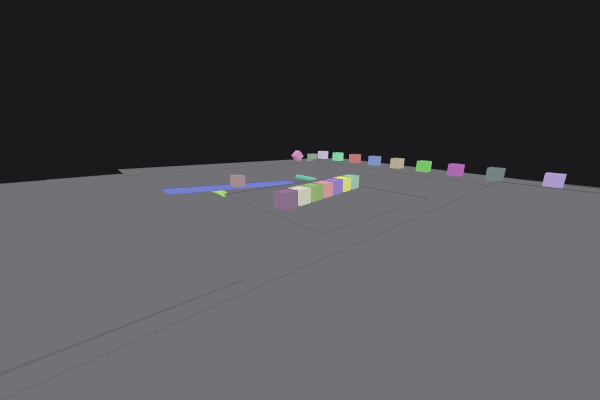<br/>
        Conveyor Belt
      </a><br/>
      <sub><a href="./samples/examples/example_conveyor_belt.cpp">source</a></sub>
    </td>
    <td align="center">
      <a href="https://isaac-mason.github.io/tumble/samples/?example=example_linear_damping">
        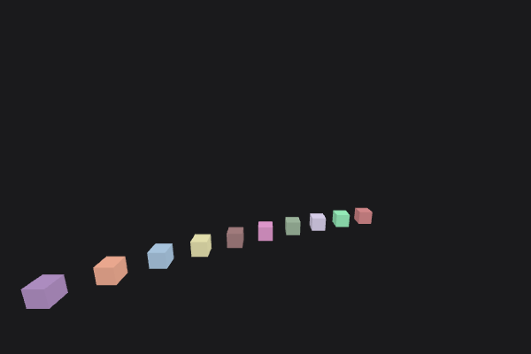<br/>
        Linear Damping
      </a><br/>
      <sub><a href="./samples/examples/example_linear_damping.cpp">source</a></sub>
    </td>
    <td align="center">
      <a href="https://isaac-mason.github.io/tumble/samples/?example=example_angular_damping">
        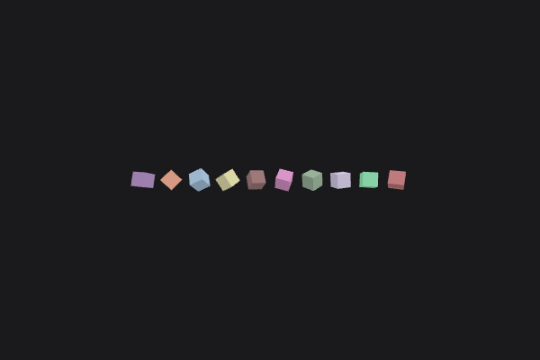<br/>
        Angular Damping
      </a><br/>
      <sub><a href="./samples/examples/example_angular_damping.cpp">source</a></sub>
    </td>
    <td align="center">
      <a href="https://isaac-mason.github.io/tumble/samples/?example=example_gravity_factor">
        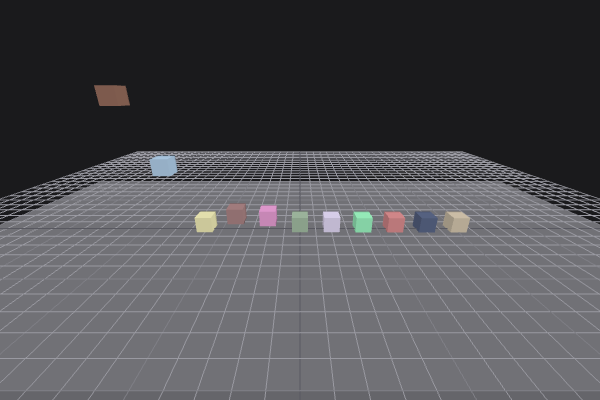<br/>
        Gravity Factor
      </a><br/>
      <sub><a href="./samples/examples/example_gravity_factor.cpp">source</a></sub>
    </td>
  </tr>
  <tr>
    <td align="center">
      <a href="https://isaac-mason.github.io/tumble/samples/?example=example_mass_properties">
        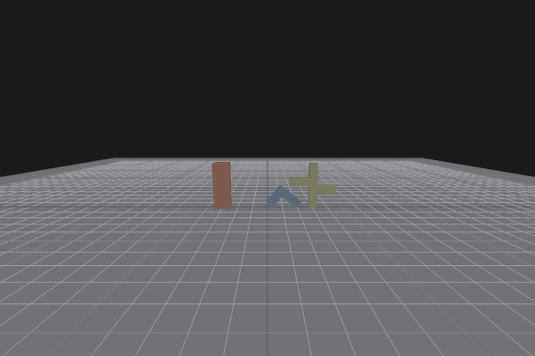<br/>
        Mass Properties
      </a><br/>
      <sub><a href="./samples/examples/example_mass_properties.cpp">source</a></sub>
    </td>
    <td align="center">
      <a href="https://isaac-mason.github.io/tumble/samples/?example=example_add_impulse_at_position">
        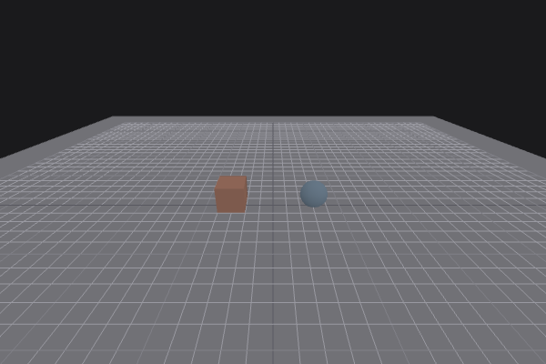<br/>
        Add Impulse at Position
      </a><br/>
      <sub><a href="./samples/examples/example_add_impulse_at_position.cpp">source</a></sub>
    </td>
    <td align="center">
      <a href="https://isaac-mason.github.io/tumble/samples/?example=example_cast_ray">
        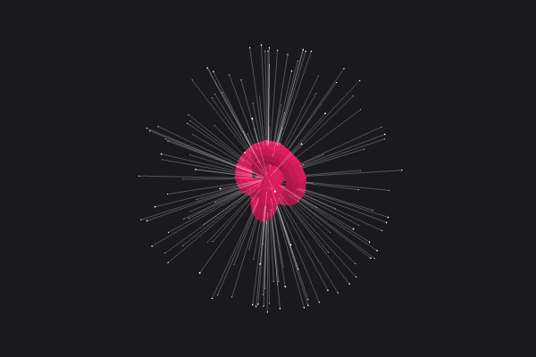<br/>
        Cast Ray
      </a><br/>
      <sub><a href="./samples/examples/example_cast_ray.cpp">source</a></sub>
    </td>
    <td align="center">
      <a href="https://isaac-mason.github.io/tumble/samples/?example=example_cast_shape">
        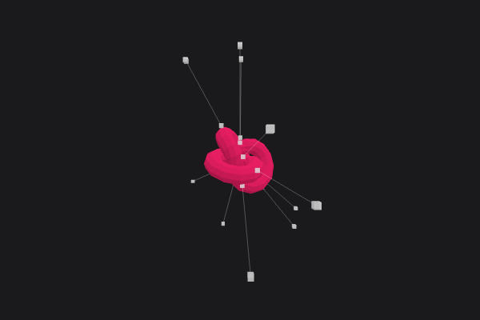<br/>
        Cast Shape
      </a><br/>
      <sub><a href="./samples/examples/example_cast_shape.cpp">source</a></sub>
    </td>
  </tr>
  <tr>
    <td align="center">
      <a href="https://isaac-mason.github.io/tumble/samples/?example=example_collide_point">
        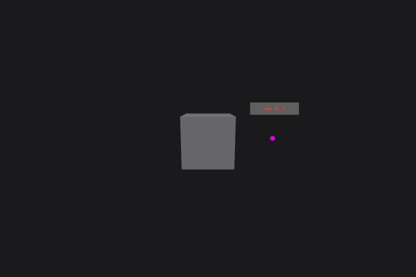<br/>
        Collide Point
      </a><br/>
      <sub><a href="./samples/examples/example_collide_point.cpp">source</a></sub>
    </td>
    <td align="center">
      <a href="https://isaac-mason.github.io/tumble/samples/?example=example_collide_shape">
        <br/>
        Collide Shape
      </a><br/>
      <sub><a href="./samples/examples/example_collide_shape.cpp">source</a></sub>
    </td>
    <td align="center">
      <a href="https://isaac-mason.github.io/tumble/samples/?example=example_sensor">
        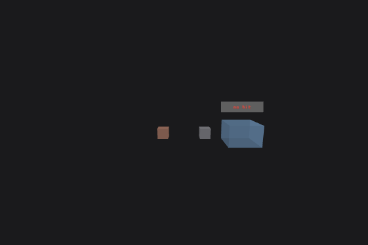<br/>
        Sensor
      </a><br/>
      <sub><a href="./samples/examples/example_sensor.cpp">source</a></sub>
    </td>
    <td align="center">
      <a href="https://isaac-mason.github.io/tumble/samples/?example=example_object_layer_filtering">
        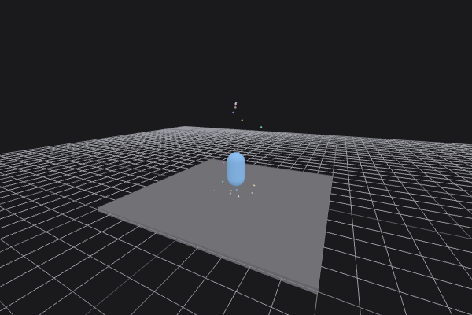<br/>
        Object Layer Filtering
      </a><br/>
      <sub><a href="./samples/examples/example_object_layer_filtering.cpp">source</a></sub>
    </td>
  </tr>
  <tr>
    <td align="center">
      <a href="https://isaac-mason.github.io/tumble/samples/?example=example_collision_filtering">
        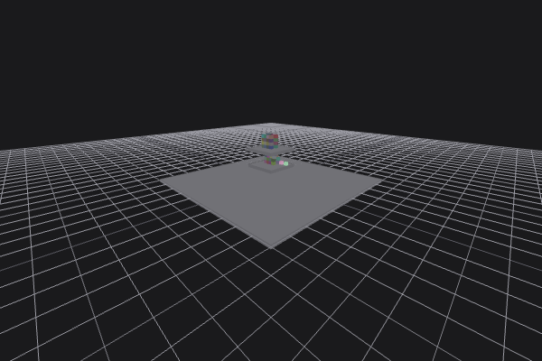<br/>
        Collision Filtering
      </a><br/>
      <sub><a href="./samples/examples/example_collision_filtering.cpp">source</a></sub>
    </td>
    <td align="center">
      <a href="https://isaac-mason.github.io/tumble/samples/?example=example_collide_shape_vs_shape">
        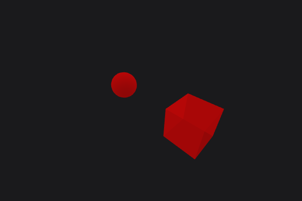<br/>
        Collide Shape vs Shape
      </a><br/>
      <sub><a href="./samples/examples/example_collide_shape_vs_shape.cpp">source</a></sub>
    </td>
    <td align="center">
      <a href="https://isaac-mason.github.io/tumble/samples/?example=example_collide_point_vs_shape">
        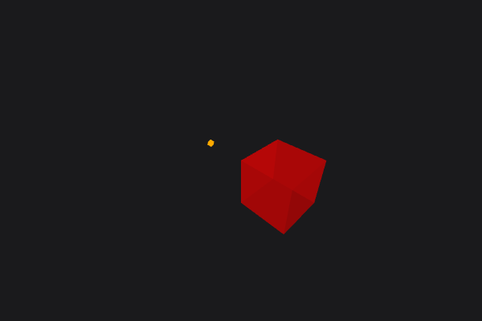<br/>
        Collide Point vs Shape
      </a><br/>
      <sub><a href="./samples/examples/example_collide_point_vs_shape.cpp">source</a></sub>
    </td>
    <td align="center">
      <a href="https://isaac-mason.github.io/tumble/samples/?example=example_cast_ray_vs_shape">
        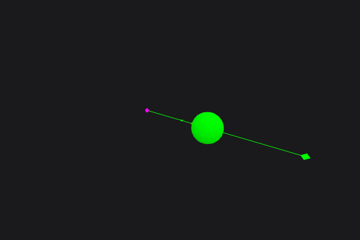<br/>
        Cast Ray vs Shape
      </a><br/>
      <sub><a href="./samples/examples/example_cast_ray_vs_shape.cpp">source</a></sub>
    </td>
  </tr>
  <tr>
    <td align="center">
      <a href="https://isaac-mason.github.io/tumble/samples/?example=example_cast_shape_vs_shape">
        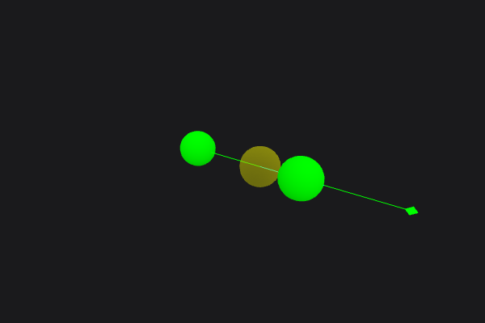<br/>
        Cast Shape vs Shape
      </a><br/>
      <sub><a href="./samples/examples/example_cast_shape_vs_shape.cpp">source</a></sub>
    </td>
    <td align="center">
      <a href="https://isaac-mason.github.io/tumble/samples/?example=example_gjk_collision_detection">
        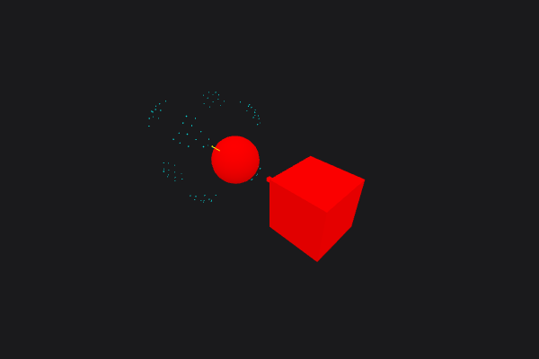<br/>
        GJK Collision Detection
      </a><br/>
      <sub><a href="./samples/examples/example_gjk.cpp">source</a></sub>
    </td>
    <td align="center">
      <a href="https://isaac-mason.github.io/tumble/samples/?example=example_get_supporting_face">
        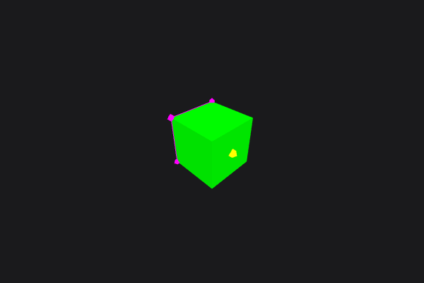<br/>
        Get Supporting Face
      </a><br/>
      <sub><a href="./samples/examples/example_get_supporting_face.cpp">source</a></sub>
    </td>
    <td align="center">
      <a href="https://isaac-mason.github.io/tumble/samples/?example=example_convex_hull_builder">
        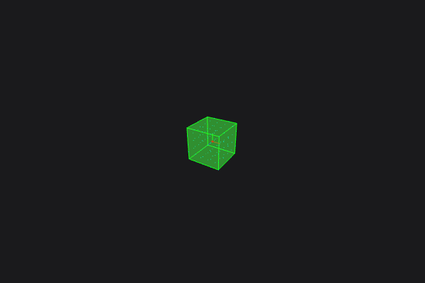<br/>
        Convex Hull Builder
      </a><br/>
      <sub><a href="./samples/examples/example_convex_hull_builder.cpp">source</a></sub>
    </td>
  </tr>
  <tr>
    <td align="center">
      <a href="https://isaac-mason.github.io/tumble/samples/?example=example_test_scenarios">
        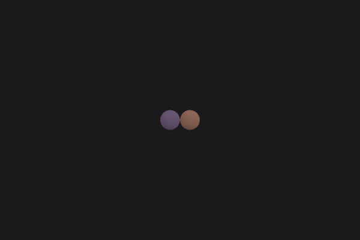<br/>
        Test Scenarios
      </a><br/>
      <sub><a href="./samples/examples/example_test_scenarios.cpp">source</a></sub>
    </td>
    <td align="center">
      <a href="https://isaac-mason.github.io/tumble/samples/?example=example_debug_renderer">
        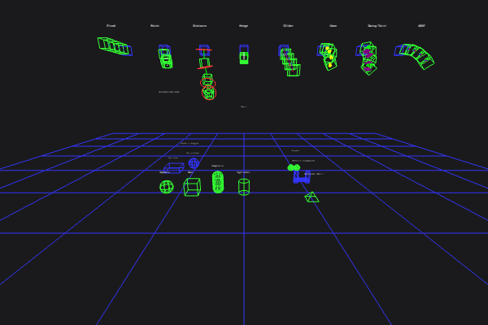<br/>
        Debug Renderer
      </a><br/>
      <sub><a href="./samples/examples/example_debug.cpp">source</a></sub>
    </td>
  </tr>
</table>

**Documentation**

This README is the guide. Every code block comes from a program in `docs/cpp/`, and the tests build and run each one.

- [Getting tumble](#getting-tumble)
  - [CMake](#cmake)
  - [Without CMake](#without-cmake)
- [Quick start](#quick-start)
- [Conventions](#conventions)
  - [Public API](#public-api)
- [Memory](#memory)
  - [Errors](#errors)
- [The world](#the-world)
  - [Layers](#layers)
  - [Settings](#settings)
  - [Stepping](#stepping)
  - [Events](#events)
  - [Active bodies](#active-bodies)
- [Rigid bodies](#rigid-bodies)
  - [Creating and removing](#creating-and-removing)
  - [Motion types](#motion-types)
  - [Position and rotation](#position-and-rotation)
  - [Velocity](#velocity)
  - [Forces and impulses](#forces-and-impulses)
  - [Mass](#mass)
  - [Damping, limits and degrees of freedom](#damping-limits-and-degrees-of-freedom)
  - [Sleeping](#sleeping)
  - [Kinematic bodies](#kinematic-bodies)
  - [Continuous collision detection](#continuous-collision-detection)
  - [User data](#user-data)
  - [Collision groups and masks](#collision-groups-and-masks)
  - [Materials](#materials)
  - [Sensors](#sensors)
  - [Changing a body's shape](#changing-a-bodys-shape)
  - [Changing a body's layer](#changing-a-bodys-layer)
- [Shapes](#shapes)
  - [Convex shapes](#convex-shapes)
  - [Convex hulls](#convex-hulls)
  - [Planes](#planes)
  - [Triangle meshes](#triangle-meshes)
  - [Compounds](#compounds)
  - [Decorators](#decorators)
  - [Empty](#empty)
  - [Freeing shapes](#freeing-shapes)
- [Contact pairs](#contact-pairs)
- [Queries](#queries)
  - [Rays](#rays)
  - [Points](#points)
  - [Overlaps](#overlaps)
  - [Sweeps](#sweeps)
  - [Bounds only](#bounds-only)
  - [Filters](#filters)
- [Constraints](#constraints)
  - [Hinge](#hinge)
  - [Point](#point)
  - [Distance](#distance)
  - [Slider](#slider)
  - [Fixed](#fixed)
  - [Swing-twist and cone](#swing-twist-and-cone)
  - [Six degrees of freedom](#six-degrees-of-freedom)
  - [Motors and springs](#motors-and-springs)
- [Character controller](#character-controller)
  - [Changing shape](#changing-shape)
  - [Listeners and policies](#listeners-and-policies)
  - [Your own loop](#your-own-loop)
  - [Contacts](#contacts)
- [Custom shapes](#custom-shapes)
- [Debug drawing](#debug-drawing)
- [Determinism](#determinism)

## Getting tumble

### CMake

tumble's `CMakeLists.txt` defines the `tumble` library and its alias `tumble::tumble`. Fetch it with `FetchContent`, or
add a checkout such as a git submodule with `add_subdirectory(path/to/tumble)`. Then link the target:

```cmake
cmake_minimum_required(VERSION 3.20)
project(game LANGUAGES CXX)

include(FetchContent)
FetchContent_Declare(tumble GIT_REPOSITORY https://github.com/isaac-mason/tumble.git GIT_TAG main)
FetchContent_MakeAvailable(tumble)

add_executable(game main.cpp)
target_link_libraries(game PRIVATE tumble::tumble)
```

The tests only build when tumble is the top-level project. It has two options:

- `TUMBLE_DEBUG` enables the library's asserts.
- `TUMBLE_NO_SIMD` uses the scalar backend where SIMD is available. Both backends give the same results.

### Without CMake

Compile every `.cpp` under `tumble/` as C++20, with the repository root on the include path. Headers are included as
`"tumble/physics/world.h"`. Use `-ffp-contract=off`, or `/fp:precise` on MSVC, and do not use fast math.

## Quick start

This creates a world and a floor, then drops a box and a ball onto it:

```cpp
#include <stdio.h>

#include "tumble/tumble.h"

using namespace tumble;

int main() {
    // register the shape types and their pair functions, once before anything collides
    dispatch::init();

    // one object layer for what moves and one for what does not, each with its own broadphase tree
    WorldSettings settings = world_settings::create();
    const uint32_t broadphase_moving = world_settings::add_broadphase_layer(settings);
    const uint32_t broadphase_not_moving = world_settings::add_broadphase_layer(settings);
    const uint32_t moving = world_settings::add_object_layer(settings, broadphase_moving);
    const uint32_t not_moving = world_settings::add_object_layer(settings, broadphase_not_moving);
    world_settings::enable_collision(settings, moving, moving);
    world_settings::enable_collision(settings, moving, not_moving);

    // the world copies the settings
    World *world = world::create(settings);

    // a static floor with its top at y = 0
    Ref<Shape> floor_shape = box::create({.half_extents = {20.0f, 0.5f, 20.0f}});
    rigid_body::create(*world, {
        .shape = floor_shape,
        .object_layer = not_moving,
        .motion_type = MotionType::STATIC,
        .position = {0.0f, -0.5f, 0.0f},
    });

    // a box and a ball, dropped onto it
    Ref<Shape> box_shape = box::create({.half_extents = {0.5f, 0.5f, 0.5f}});
    RigidBody *box = rigid_body::create(*world, {
        .shape = box_shape,
        .object_layer = moving,
        .motion_type = MotionType::DYNAMIC,
        .position = {0.0f, 4.0f, 0.0f},
    });

    Ref<Shape> ball_shape = sphere::create({.radius = 0.5f});
    RigidBody *ball = rigid_body::create(*world, {
        .shape = ball_shape,
        .object_layer = moving,
        .motion_type = MotionType::DYNAMIC,
        .position = {0.2f, 6.0f, 0.0f},
    });

    // two seconds at 60 steps a second
    for (int i = 0; i < 120; i++) world::step(*world, 1.0f / 60.0f);
    printf("box at y %.2f, ball at y %.2f\n", box->position.y, ball->position.y);

    // the world frees its bodies. your shapes are freed once nothing uses them
    world::destroy(world);
    ball_shape = nullptr;
    box_shape = nullptr;
    floor_shape = nullptr;
    return 0;
}
```

`dispatch::init()` registers the shape types and the collision function for each pair of them. Call it once, before you
make any shape. Call it again only to change the shape types (see [Custom shapes](#custom-shapes)).

The rest of this guide leaves out the includes, `using namespace tumble;` and the world setup.

## Conventions

- Everything is in `namespace tumble`.
- Types are directly in `tumble`, such as `RigidBody`, `Shape` and `BoxShapeSettings`. A type that is part of another
  is nested in it, such as `KCC::ContactEvent` and `ConvexHullShape::BuildResult`.
- Functions and constants are in a namespace per subject, named after its header. For example, `rigid_body::create` is
  in `tumble/physics/body/rigid_body.h`.
- Enums are scoped, such as `MotionType::DYNAMIC` and `ShapeType::BOX`.
- A function that changes a world takes the world first: `rigid_body::set_position(world, body, ...)`.
- Settings structs hold storage types: `Float3`, `Float4` and plain floats. They work with designated initializers,
  which C++20 requires in declaration order.
- Functions take register types such as `Vec3f` and `Quatf`. Make them with functions like `vec3f::make` and
  `quatf::set_axis_angle`, or load them from storage with `vec3f::load`.
- Units are metres, kilograms, seconds and radians.
- Values free their memory when they go out of scope. This covers settings, filters, collectors and debug draws.
- `world::create` makes a world and `world::destroy` frees it, with its bodies and constraints.
- Shapes and characters are reference counted. Hold one in a `Ref<Shape>` or `Ref<KCC>`. The last `Ref` to let go
  frees it.

### Public API

`tumble/tumble.h` includes the whole API, as the quick start does. You can also include only the headers you use.

These headers are tumble's API. The rest are internals. They can change without notice, and you never need them:

- **The world:** `world.h`, `world_settings.h`, `layers.h`, `filter.h`, `update.h`, `events.h`, `contact_pairs.h` and
  `debug.h`. `update.h` has the phases of a step, which you can run yourself.
- **Bodies:** `body/rigid_body.h`, `body/body_id.h`, `body/motion_type.h`, `body/dof.h`, `body/mass_properties.h` and
  `body/sub_shape.h`. You can read a body's fields. Change them only through `rigid_body` functions, which keep the
  broadphase, the pairs and the sleep state up to date.
- **Shapes:** each shape's header under `shapes/`, and `shapes/dispatch.h`. The builders and data in `shapes/utils/`
  are `convex_hull_builder.h`, `triangle_mesh_builder.h` and `triangle_mesh_data.h`.
- **Queries:** `query.h` and `broadphase_query.h`. The collectors, settings and hits are in `collision/collector.h`,
  `collision/cast_ray_vs_shape.h`, `collision/cast_shape_vs_shape.h`, `collision/collide_point_vs_shape.h` and
  `collision/collide_shape_vs_shape.h`. Also `collision/estimate_collision_response.h`.
- **Constraints:** each constraint's header under `constraints/`, plus `constraints/constraint_id.h`,
  `constraints/contact_settings.h`, `constraints/constraint_part/motor_settings.h` and
  `constraints/constraint_part/spring_settings.h`. `world::set_materials` takes `WorldMaterial` from
  `contact_constraints.h`. The rest of that header is internal.
- **Characters:** `character/kcc.h` and `character/kcc_policy.h`. Add `character/character_constraints.h` to write
  your own controller.
- **Custom shapes:** `shapes/shapes.h` has `ShapeDef`, `allocate`, and the collide and cast tables. Also
  `shapes/convex.h`, `collision/narrowphase.h` to collide or cast the shapes inside yours, `collision/support.h` for a
  convex type's support, and `utils/face.h`.
- **Maths and memory:** `tumble/math/`, `util/alloc.h`, `util/error.h`, `util/collections.h` and `util/ref.h`.

## Memory

tumble gets all its memory from one allocator. A hosted build starts with aligned `malloc` and `free`. Set your own
before anything allocates. tumble passes the size back when it frees a block, so your allocator does not need to store
it:

```cpp
/** a bump allocator over a block of its own: frees count what came back, but nothing is reused */
struct Arena {
    alignas(64) unsigned char memory[1 << 20];
    size_t used;
    size_t freed;
};

void *arena_allocate(size_t size, size_t alignment, void *user) {
    Arena &arena = *static_cast<Arena *>(user);
    const size_t at = util::align_up(arena.used, alignment);
    if (at + size > sizeof(arena.memory)) return nullptr;
    arena.used = at + size;
    return arena.memory + at;
}

void arena_free(void *, size_t size, void *user) { static_cast<Arena *>(user)->freed += size; }

static Arena arena;
```

```cpp
// set the allocator before anything allocates. from here on, every block tumble takes comes
// from the arena
util::set_allocator({arena_allocate, arena_free, &arena});
```

`util::allocated_bytes` and `util::allocated_blocks` count the memory tumble holds:

```cpp
WorldSettings settings = world_settings::create();
world_settings::add_object_layer(settings, world_settings::add_broadphase_layer(settings));
World *world = world::create(settings);
printf("a world holds %zu bytes in %zu blocks\n",
       util::allocated_bytes(), util::allocated_blocks());

world::destroy(world);
// the settings are a value. they hold their layer tables until they leave scope
printf("after destroy: %zu bytes, the settings' own\n", util::allocated_bytes());
```

### Errors

Running out of memory stops the program. When the allocator returns null, tumble sets `Error::OUT_OF_MEMORY` in the
error word and traps. In a browser, the wasm instance cannot be used after that, and the error word says why. Nothing
else in tumble can fail for lack of memory, so nothing checks for it.

The only other error is a full pool. `rigid_body::create` and the constraint `create` functions then set
`Error::QUOTA` and return null or an invalid id. The first error stays set until you call `util::error_clear()`.

## The world

A world holds bodies, constraints and the simulation state. You can run several worlds at once.

### Layers

Object layers decide what collides with what. Each object layer belongs to a broadphase layer, and each broadphase
layer has its own tree. A query or the pair search only visits trees whose layers can collide. Put moving and static
bodies in separate broadphase layers.

```cpp
// object layers decide what collides with what. each one maps to a broadphase layer, which has
// its own tree. a query or the pair search only walks trees whose layers can collide
struct ObjectLayers {
    uint32_t moving;
    uint32_t not_moving;
    uint32_t debris;
};

WorldSettings make_settings(ObjectLayers &out) {
    WorldSettings settings = world_settings::create();
    const uint32_t broadphase_moving = world_settings::add_broadphase_layer(settings);
    const uint32_t broadphase_not_moving = world_settings::add_broadphase_layer(settings);

    out.moving = world_settings::add_object_layer(settings, broadphase_moving);
    out.not_moving = world_settings::add_object_layer(settings, broadphase_not_moving);
    out.debris = world_settings::add_object_layer(settings, broadphase_moving);

    world_settings::enable_collision(settings, out.moving, out.moving);
    world_settings::enable_collision(settings, out.moving, out.not_moving);
    // debris lands on the ground and nothing else
    world_settings::enable_collision(settings, out.debris, out.not_moving);
    return settings;
}
```

<table>
  <tr>
    <td align="center">
      <a href="https://isaac-mason.github.io/tumble/samples/?example=example_object_layer_filtering">
        <br/>
        <strong>Object Layer Filtering</strong>
      </a><br/>
      <sub><a href="./samples/examples/example_object_layer_filtering.cpp">source</a></sub>
    </td>
  </tr>
</table>

### Settings

`WorldSettings` holds the layers, gravity, and the solver, narrowphase, sleeping and CCD settings. The defaults suit
most games. `world::create` copies the settings, so you can free them right after, or use them for another world:

```cpp
ObjectLayers layers;
WorldSettings settings = make_settings(layers);
settings.gravity = {0.0f, -20.0f, 0.0f};
settings.solver.velocity_iterations = 8;
settings.sleeping.time_before_sleep = 1.0f;
World *world = world::create(settings);

// a second world from the same settings is independent
World *preview = world::create(settings);
```

### Stepping

`world::step(world, delta_time)` advances the world by one step. Step by a fixed time, and catch up a few steps when a
frame runs long. Then the simulation does not depend on the frame rate:

```cpp
// whatever the frame time, the world advances in steps of 1/60 s. a long frame catches up a
// few steps at most
const float step_time = 1.0f / 60.0f;
const int max_steps_per_frame = 4;
float accumulator = 0.0f;

const float frame_times[] = {0.016f, 0.017f, 0.033f, 0.2f};
for (float frame_time : frame_times) {
    accumulator += frame_time;
    for (int steps = 0; accumulator >= step_time && steps < max_steps_per_frame; steps++) {
        world::step(*world, step_time);
        accumulator -= step_time;
    }
    if (accumulator > step_time) accumulator = 0.0f;
}
```

A resting body can sink into the body below by up to `settings.solver.penetration_slop`, which is 2 cm. This keeps
stacks from jittering.

### Events

There are no callbacks. A step runs in phases. Between two phases, you read what the last phase found in
`world.events`. You can reject or change an event on the event itself, and the next phase reads that. `world::step`
runs all the phases and changes nothing. To reject or change events, run the phases yourself:

```cpp
// world::step runs these phases and changes nothing. between phases, the world's events say what
// a phase found, and you can reject or change them. here pairs with a body whose user data is 7
// are rejected, so that body passes through everything. no contact bounces
void step_with_changes(World &world, float delta_time) {
    update::step_begin(world, delta_time);
    do {
        update::find_pairs(world);
        for (uint32_t i = 0; i < world.events.pairs.length; i++) {
            PairEvent &pair = world.events.pairs[i];
            if (pair.user_data_a == 7 || pair.user_data_b == 7) pair.rejected = true;
        }
        update::narrowphase(world);
    } while (world.events.woken > 0);

    // after the last narrowphase, change the contacts it added or kept
    for (uint32_t i = 0; i < world.events.contacts_added.length; i++) {
        ContactEvent &contact = world.events.contacts_added[i];
        events::change_contact(contact).combined_restitution = 0.0f;
    }
    for (uint32_t i = 0; i < world.events.contacts_persisted.length; i++) {
        ContactEvent &contact = world.events.contacts_persisted[i];
        events::change_contact(contact).combined_restitution = 0.0f;
    }

    update::solve(world);
    update::step_end(world);
}
```

- After `find_pairs`, `events.pairs` holds the pairs of bodies whose bounds overlap. Set a pair's `rejected` to drop it
  before the narrowphase.
- After `narrowphase`, `events.contacts_added` and `events.contacts_persisted` hold its contacts, each with its manifold
  and combined material. Set a contact's `rejected` to drop it before the solve. `events::change_contact` returns its
  settings to change how it is solved.
- A rejected contact is not recorded in contact pairs.
- After `narrowphase`, `events.woken` counts the bodies its contacts woke. While it is above zero, find their pairs and
  run the narrowphase again.

The conveyor belt sample changes its contacts' surface velocities between the phases:

<table>
  <tr>
    <td align="center">
      <a href="https://isaac-mason.github.io/tumble/samples/?example=example_conveyor_belt">
        <br/>
        <strong>Conveyor Belt</strong>
      </a><br/>
      <sub><a href="./samples/examples/example_conveyor_belt.cpp">source</a></sub>
    </td>
  </tr>
</table>

After a step, the events describe what it did:

```cpp
// after a step, the events hold the contacts it found, kept and lost, and the bodies still
// active. the next step moves those bodies
void print_events(const World &world) {
    for (uint32_t i = 0; i < world.events.contacts_added.length; i++) {
        const ContactEvent &contact = world.events.contacts_added[i];
        const uint32_t a = body_id::index(contact.body_id_a);
        const uint32_t b = body_id::index(contact.body_id_b);
        printf("contact %u - %u\n", a, b);
        printf("  %u points, %.3f deep\n", contact.num_points, contact.penetration);
    }
    printf("%u contacts kept\n", world.events.contacts_persisted.length);
    printf("%u contacts removed\n", world.events.contacts_removed.length);
    printf("%u bodies active\n", world::get_num_active_bodies(world));
}
```

`contacts_removed` also holds the contacts of bodies removed since the last step. So a removal's events arrive with the
next step.

### Active bodies

The active list holds the dynamic and kinematic bodies that are awake. Read it with `world::get_num_active_bodies` and
`world::get_active_bodies`. Entries are indices into `bodies.pool`, valid until the list next changes. After a step, the
list names every body the step moved, except those it put to sleep.

An activation listener hears each body join or leave the list. It hears changes from the step, and from calls such as
`rigid_body::wake`, as they happen:

```cpp
// the listener hears each body join or leave the active list, whatever moved it. a recorder is
// a listener that keeps what it hears, so you can hand it on later, here after the steps
BodyActivationRecorder recorder;
body_activation::init_recorder(recorder);
world::set_body_activation_listener(*world, &recorder.listener);
```

```cpp
// the bodies the steps put to sleep and woke, in order
const auto on_wake = [](BodyActivationListener &, BodyId body, uint64_t) {
    printf("%u woke\n", body_id::index(body));
};
const auto on_sleep = [](BodyActivationListener &, BodyId body, uint64_t) {
    printf("%u slept\n", body_id::index(body));
};
BodyActivationListener print = {on_wake, on_sleep, nullptr};
body_activation::flush(recorder, &print);
world::set_body_activation_listener(*world, nullptr);
```

## Rigid bodies

### Creating and removing

```cpp
// a body joins the world at create, and the next step finds it. the body holds its shape
RigidBody *crate = rigid_body::create(*world, {
    .shape = box_shape,
    .object_layer = moving,
    .motion_type = MotionType::DYNAMIC,
    .position = {0.0f, 2.0f, 0.0f},
    .friction = 0.6f,
});

// its id names it while it exists. get returns the body for an id, or null once it is gone
const BodyId id = crate->id;
rigid_body::get(*world, id);

// remove takes the body out of the world, with its constraints. its contacts' removal
// events come with the next step
rigid_body::remove(*world, crate);
```

A body pointer stays valid while the body exists. Its id is safe to keep after that. `rigid_body::get` returns null for
a removed body's id, even after its slot is reused.

### Motion types

```cpp
// a static body never moves. a kinematic body moves by its velocity and pushes dynamic bodies
// aside. a dynamic body is moved by gravity, forces and contacts
RigidBody *platform = rigid_body::create(*world, {
    .shape = box_shape,
    .object_layer = moving,
    .motion_type = MotionType::KINEMATIC,
    .position = {4.0f, 1.0f, 0.0f},
});

// a body can change its motion type. `wake` wakes a body that keeps moving
rigid_body::set_motion_type(*world, platform, MotionType::DYNAMIC, true);
```

### Position and rotation

```cpp
// these teleport the body. the broadphase and the pairs update, and `wake` wakes a sleeping body
const Quatf turned = quatf::set_axis_angle(vec3f::axis_y(), 0.5f);
rigid_body::set_position(*world, body, vec3f::make(0.0f, 3.0f, 0.0f), true);
rigid_body::set_quaternion(*world, body, turned, true);
rigid_body::set_transform(*world, body, vec3f::make(0.0f, 0.5f, 0.0f), quatf::identity(), true);

// read the pose from the body's fields. position is the shape's origin, and
// center_of_mass_position is its centre of mass
const Float3 &position = body->position;
printf("at %.2f %.2f %.2f\n", position.x, position.y, position.z);
```

Setting a position teleports the body and skips the simulation in between. Nothing it passes through stops it. To move
a kinematic body, set its velocity instead (see [Kinematic bodies](#kinematic-bodies)).

### Velocity

```cpp
// in metres and radians per second, in world space. setting either wakes the body
rigid_body::set_linear_velocity(*world, body, vec3f::make(2.0f, 0.0f, 0.0f));
rigid_body::set_angular_velocity(*world, body, vec3f::make(0.0f, 1.0f, 0.0f));
rigid_body::add_linear_velocity(*world, body, vec3f::make(0.0f, 1.0f, 0.0f));

// the velocity of any point on the body, from its linear and angular velocity
const Vec3f corner = vec3f::make(0.5f, 1.0f, 0.5f);
const Vec3f corner_velocity = rigid_body::get_velocity_at_point(body, corner);
```

### Forces and impulses

```cpp
// a force acts over the next step, then is cleared
rigid_body::add_force(*world, body, vec3f::make(0.0f, 2000.0f, 0.0f), true);
rigid_body::add_torque(*world, body, vec3f::make(0.0f, 10.0f, 0.0f), true);

// a force away from the centre of mass turns the body too
const Vec3f push = vec3f::make(100.0f, 0.0f, 0.0f);
const Vec3f at = vec3f::make(0.0f, 1.0f, 0.0f);
rigid_body::add_force_at_position(*world, body, push, at, true);

// an impulse changes the velocity at once
rigid_body::add_impulse(*world, body, vec3f::make(0.0f, 500.0f, 0.0f));
rigid_body::add_angular_impulse(*world, body, vec3f::make(0.0f, 50.0f, 0.0f));
```

Forces and impulses only move dynamic bodies.

<table>
  <tr>
    <td align="center">
      <a href="https://isaac-mason.github.io/tumble/samples/?example=example_add_impulse_at_position">
        <br/>
        <strong>Add Impulse at Position</strong>
      </a><br/>
      <sub><a href="./samples/examples/example_add_impulse_at_position.cpp">source</a></sub>
    </td>
  </tr>
</table>

### Mass

```cpp
// the mass comes from the shape's density by default, which is 1000 kg/m3, so the unit box
// weighs 1000 kg. `mass` scales the shape's inertia to a mass you choose
RigidBody *light = rigid_body::create(*world, {
    .shape = box_shape,
    .object_layer = moving,
    .motion_type = MotionType::DYNAMIC,
    .position = {3.0f, 0.5f, 3.0f},
    .mass = 10.0f,
});

// mass_properties_override sets the mass and inertia directly
MassProperties heavy = mass_properties::create();
mass_properties::set_mass_and_inertia_of_solid_box(heavy, vec3f::make(1.0f, 1.0f, 1.0f), 200.0f);
RigidBody *given = rigid_body::create(*world, {
    .shape = box_shape,
    .object_layer = moving,
    .motion_type = MotionType::DYNAMIC,
    .position = {-3.0f, 0.5f, 3.0f},
    .mass_properties_override = &heavy,
});
```

A triangle mesh has no volume, so it has no mass. A dynamic body with a mesh shape needs `mass_properties_override`.

<table>
  <tr>
    <td align="center">
      <a href="https://isaac-mason.github.io/tumble/samples/?example=example_mass_properties">
        <br/>
        <strong>Mass Properties</strong>
      </a><br/>
      <sub><a href="./samples/examples/example_mass_properties.cpp">source</a></sub>
    </td>
  </tr>
</table>

### Damping, limits and degrees of freedom

```cpp
// damping slows a body a little every step, and the limits clamp its velocities.
// gravity_factor scales gravity for this body alone, and 0 makes it float.
// allowed_degrees_of_freedom locks axes: this body only slides in x and y
RigidBody *puck = rigid_body::create(*world, {
    .shape = box_shape,
    .object_layer = moving,
    .motion_type = MotionType::DYNAMIC,
    .position = {6.0f, 3.0f, 0.0f},
    .allowed_degrees_of_freedom = dof::TRANSLATION_X | dof::TRANSLATION_Y,
    .gravity_factor = 0.0f,
    .linear_damping = 0.0f,
    .angular_damping = 0.0f,
    .max_linear_velocity = 20.0f,
});
rigid_body::set_linear_velocity(*world, puck, vec3f::make(30.0f, 0.0f, 5.0f));
```

<table>
  <tr>
    <td align="center">
      <a href="https://isaac-mason.github.io/tumble/samples/?example=example_linear_damping">
        <br/>
        <strong>Linear Damping</strong>
      </a><br/>
      <sub><a href="./samples/examples/example_linear_damping.cpp">source</a></sub>
    </td>
    <td align="center">
      <a href="https://isaac-mason.github.io/tumble/samples/?example=example_angular_damping">
        <br/>
        <strong>Angular Damping</strong>
      </a><br/>
      <sub><a href="./samples/examples/example_angular_damping.cpp">source</a></sub>
    </td>
    <td align="center">
      <a href="https://isaac-mason.github.io/tumble/samples/?example=example_gravity_factor">
        <br/>
        <strong>Gravity Factor</strong>
      </a><br/>
      <sub><a href="./samples/examples/example_gravity_factor.cpp">source</a></sub>
    </td>
  </tr>
</table>

### Sleeping

```cpp
// a body that has barely moved for a while sleeps. it costs nothing until something touches
// or wakes it. set allow_sleeping to false to keep it awake. sleep and wake do it by hand
rigid_body::sleep(*world, body);
rigid_body::wake(*world, body);
```

### Kinematic bodies

```cpp
// a kinematic body follows a path by its velocities. move_kinematic sets the velocities that
// reach the target in one step
RigidBody *lift = rigid_body::create(*world, {
    .shape = box_shape,
    .object_layer = moving,
    .motion_type = MotionType::KINEMATIC,
    .position = {-6.0f, 0.5f, 0.0f},
});

const float step_time = 1.0f / 60.0f;
for (int i = 1; i <= 60; i++) {
    const Vec3f target = vec3f::make(-6.0f, 0.5f + 2.0f * (float)i / 60.0f, 0.0f);
    rigid_body::move_kinematic(*world, lift, target, quatf::identity(), step_time);
    world::step(*world, step_time);
}
```

`move_kinematic` wakes the body, so a lift waiting at rest starts moving.

<table>
  <tr>
    <td align="center">
      <a href="https://isaac-mason.github.io/tumble/samples/?example=example_kinematic_body">
        <br/>
        <strong>Kinematic Body</strong>
      </a><br/>
      <sub><a href="./samples/examples/example_kinematic.cpp">source</a></sub>
    </td>
  </tr>
</table>

### Continuous collision detection

```cpp
// a small fast body can pass through a thin one between two steps. linear casting sweeps
// it, so it stops at what it would hit. this costs more
Ref<Shape> pellet_shape = sphere::create({.radius = 0.05f});
RigidBody *pellet = rigid_body::create(*world, {
    .shape = pellet_shape,
    .object_layer = moving,
    .motion_type = MotionType::DYNAMIC,
    .position = {10.0f, 5.0f, 0.0f},
    .motion_quality = MotionQuality::LINEAR_CAST,
});
rigid_body::set_linear_velocity(*world, pellet, vec3f::make(0.0f, -200.0f, 0.0f));
```

<table>
  <tr>
    <td align="center">
      <a href="https://isaac-mason.github.io/tumble/samples/?example=example_continuous_collision_detection">
        <br/>
        <strong>Continuous Collision Detection</strong>
      </a><br/>
      <sub><a href="./samples/examples/example_ccd.cpp">source</a></sub>
    </td>
  </tr>
</table>

### User data

```cpp
// your own value for the body, such as an entity id, an index or a pointer. every event with
// the body carries it
RigidBody *tagged = rigid_body::create(*world, {
    .shape = box_shape,
    .object_layer = moving,
    .motion_type = MotionType::DYNAMIC,
    .user_data = 42,
    .position = {0.0f, 0.5f, 6.0f},
});
tagged->user_data = 43;
```

### Collision groups and masks

```cpp
// groups and masks filter within one object layer. two bodies collide when each one's mask
// has a bit of the other's groups
constexpr uint32_t PLAYERS = 1u << 0;
constexpr uint32_t PROJECTILES = 1u << 1;

RigidBody *player = rigid_body::create(*world, {
    .shape = box_shape,
    .object_layer = moving,
    .motion_type = MotionType::DYNAMIC,
    .position = {-10.0f, 0.5f, 0.0f},
    .collision_groups = PLAYERS,
    .collision_mask = ~PROJECTILES,
});

// the player's own shots pass through the player
RigidBody *shot = rigid_body::create(*world, {
    .shape = box_shape,
    .object_layer = moving,
    .motion_type = MotionType::DYNAMIC,
    .position = {-10.0f, 3.0f, 0.0f},
    .collision_groups = PROJECTILES,
    .collision_mask = ~PLAYERS,
});
```

<table>
  <tr>
    <td align="center">
      <a href="https://isaac-mason.github.io/tumble/samples/?example=example_collision_filtering">
        <br/>
        <strong>Collision Filtering</strong>
      </a><br/>
      <sub><a href="./samples/examples/example_collision_filtering.cpp">source</a></sub>
    </td>
  </tr>
</table>

### Materials

```cpp
// each body's combine mode decides how friction and restitution combine in a contact. the
// more restrictive mode wins
RigidBody *bouncy = rigid_body::create(*world, {
    .shape = box_shape,
    .object_layer = moving,
    .motion_type = MotionType::DYNAMIC,
    .position = {12.0f, 4.0f, 0.0f},
    .friction = 0.9f,
    .restitution = 0.8f,
    .restitution_combine_mode = MaterialCombineMode::MAX,
});
```

`world::set_materials` gives the world a table of materials. A shape's or a triangle's `material_id` picks one. On that
side of a contact, the material replaces the body's friction and restitution.

A query hit names the part it hit with a sub shape id. `rigid_body::get_material(body, hit.sub_shape_id)` returns that
part's material id.

<table>
  <tr>
    <td align="center">
      <a href="https://isaac-mason.github.io/tumble/samples/?example=example_friction">
        <br/>
        <strong>Friction</strong>
      </a><br/>
      <sub><a href="./samples/examples/example_friction.cpp">source</a></sub>
    </td>
    <td align="center">
      <a href="https://isaac-mason.github.io/tumble/samples/?example=example_restitution">
        <br/>
        <strong>Restitution</strong>
      </a><br/>
      <sub><a href="./samples/examples/example_restitution.cpp">source</a></sub>
    </td>
  </tr>
</table>

### Sensors

```cpp
// a sensor reports its contacts but pushes nothing. use it as a trigger volume
RigidBody *trigger = rigid_body::create(*world, {
    .shape = box_shape,
    .object_layer = moving,
    .motion_type = MotionType::KINEMATIC,
    .position = {14.0f, 0.5f, 0.0f},
    .sensor = true,
});
```

<table>
  <tr>
    <td align="center">
      <a href="https://isaac-mason.github.io/tumble/samples/?example=example_sensor">
        <br/>
        <strong>Sensor</strong>
      </a><br/>
      <sub><a href="./samples/examples/example_sensor.cpp">source</a></sub>
    </td>
  </tr>
</table>

### Changing a body's shape

```cpp
// a new shape updates the mass and bounds. constraints keep their anchors where they were on
// the body
Ref<Shape> bigger = box::create({.half_extents = {1.0f, 1.0f, 1.0f}});
rigid_body::set_shape(*world, body, bigger, true);

// after changing a shape in place, pass it to set_shape for each body that uses it
shapes::as<BoxShape>(bigger).half_extents = {1.0f, 2.0f, 1.0f};
box::update(bigger);
rigid_body::set_shape(*world, body, bigger, true);
```

### Changing a body's layer

```cpp
// moving a body to another object layer moves it to that layer's broadphase tree. then it
// finds its pairs again
rigid_body::set_object_layer(*world, body, not_moving);
```

## Shapes

Each shape type has a `create` function. Any number of bodies can share a shape.

Shapes are reference counted. Anything that holds a shape holds a `Ref<Shape>` to it. This includes bodies,
characters, shapes built from it, and your code. The last holder to let go frees it. A function that only reads a shape
takes a plain `Shape *`.

A shape's geometry is centred on its origin. The body's pose places it in the world.

<table>
  <tr>
    <td align="center">
      <a href="https://isaac-mason.github.io/tumble/samples/?example=example_shapes">
        <br/>
        <strong>Shapes</strong>
      </a><br/>
      <sub><a href="./samples/examples/example_shapes.cpp">source</a></sub>
    </td>
    <td align="center">
      <a href="https://isaac-mason.github.io/tumble/samples/?example=example_cube_heap">
        <br/>
        <strong>Cube Heap</strong>
      </a><br/>
      <sub><a href="./samples/examples/example_cube_heap.cpp">source</a></sub>
    </td>
    <td align="center">
      <a href="https://isaac-mason.github.io/tumble/samples/?example=example_cluster">
        <br/>
        <strong>Cluster</strong>
      </a><br/>
      <sub><a href="./samples/examples/example_cluster.cpp">source</a></sub>
    </td>
  </tr>
</table>

### Convex shapes

```cpp
// the convex primitives, centred on their origin. a body takes its mass from their volume and
// density
Ref<Shape> ball = sphere::create({.radius = 0.5f});
Ref<Shape> crate = box::create({.half_extents = {0.5f, 0.25f, 0.5f}, .density = 500.0f});

// y is the long axis of a capsule and a cylinder. a capsule's radius is its convex radius
Ref<Shape> pill = capsule::create({.half_height_of_cylinder = 0.5f, .radius = 0.25f});
Ref<Shape> can = cylinder::create({.half_height = 0.4f, .radius = 0.3f});
```

A box's or a cylinder's `convex_radius` rounds its edges a little. This makes collisions faster and steadier.

### Convex hulls

```cpp
// any point cloud. the shape builds its hull, and any number of bodies can share the shape
const float points[] = {
    -0.5f, 0.0f, -0.5f,
    0.5f, 0.0f, -0.5f,
    0.5f, 0.0f, 0.5f,
    -0.5f, 0.0f, 0.5f,
    0.0f, 0.8f, 0.0f,
    0.1f, 0.2f, 0.1f,
};
ConvexHullShape::BuildResult result;
Ref<Shape> pyramid = convex_hull::create({.positions = points, .num_positions = 6}, &result);
if (pyramid == nullptr) printf("no hull: build result %u\n", (uint32_t)result);

Ref<Shape> heavy_pyramid = convex_hull::create({
    .positions = points,
    .num_positions = 6,
    .density = 4000.0f,
});
```

<table>
  <tr>
    <td align="center">
      <a href="https://isaac-mason.github.io/tumble/samples/?example=example_convex_hull_builder">
        <br/>
        <strong>Convex Hull Builder</strong>
      </a><br/>
      <sub><a href="./samples/examples/example_convex_hull_builder.cpp">source</a></sub>
    </td>
  </tr>
</table>

### Planes

```cpp
// an infinite ground. the plane is point . normal + constant = 0, and the normal points out of
// its front
Ref<Shape> ground = plane::create({.plane = {{0.0f, 1.0f, 0.0f}, 0.0f}});
rigid_body::create(*world, {
    .shape = ground,
    .object_layer = not_moving,
    .motion_type = MotionType::STATIC,
});
```

### Triangle meshes

```cpp
// static geometry from triangles, counter clockwise seen from the front. the shape builds its
// bvh and finds the edges a sliding body must not catch on
const float ramp_positions[] = {
    -2.0f, 0.0f, -2.0f,
    2.0f, 0.0f, -2.0f,
    2.0f, 1.0f, 2.0f,
    -2.0f, 1.0f, 2.0f,
};
const uint32_t ramp_indices[] = {0, 2, 1, 0, 3, 2};
Ref<Shape> ramp = triangle_mesh::create({
    .positions = ramp_positions,
    .num_positions = 4,
    .indices = ramp_indices,
    .num_indices = 6,
});
rigid_body::create(*world, {
    .shape = ramp,
    .object_layer = not_moving,
    .motion_type = MotionType::STATIC,
    .position = {20.0f, 0.0f, 0.0f},
});
```

Use meshes for static bodies. A mesh is hollow. It has no volume, no inside and no mass.

<table>
  <tr>
    <td align="center">
      <a href="https://isaac-mason.github.io/tumble/samples/?example=example_triangle_mesh">
        <br/>
        <strong>Triangle Mesh</strong>
      </a><br/>
      <sub><a href="./samples/examples/example_triangle_mesh.cpp">source</a></sub>
    </td>
    <td align="center">
      <a href="https://isaac-mason.github.io/tumble/samples/?example=example_voxel_triangle_mesh">
        <br/>
        <strong>Voxel Triangle Mesh</strong>
      </a><br/>
      <sub><a href="./samples/examples/example_voxel_triangle_mesh.cpp">source</a></sub>
    </td>
  </tr>
</table>

### Compounds

```cpp
// several shapes as one body, each at its own pose. the compound holds its shapes
const Float4 upright = {0.0f, 0.0f, 0.0f, 1.0f};
const Float4 on_its_side = {0.0f, 0.0f, 0.70710678f, 0.70710678f};
const CompoundShapeSettings::Child dumbbell_parts[] = {
    {.position = {-0.6f, 0.0f, 0.0f}, .quaternion = upright, .shape = ball},
    {.position = {0.6f, 0.0f, 0.0f}, .quaternion = upright, .shape = ball},
    {.position = {0.0f, 0.0f, 0.0f}, .quaternion = on_its_side, .shape = pill},
};
Ref<Shape> dumbbell = compound::create({.children = dumbbell_parts, .num_children = 3});

// a static compound is built once into a bvh. use it for many children that never change
CompoundShapeSettings::Child fence_posts[16];
for (uint32_t i = 0; i < 16; i++) {
    fence_posts[i] = {.position = {(float)i, 0.4f, 0.0f}, .quaternion = upright, .shape = can};
}
Ref<Shape> fence = static_compound::create({.children = fence_posts, .num_children = 16});
rigid_body::create(*world, {
    .shape = fence,
    .object_layer = not_moving,
    .motion_type = MotionType::STATIC,
    .position = {-20.0f, 0.0f, 0.0f},
});
```

<table>
  <tr>
    <td align="center">
      <a href="https://isaac-mason.github.io/tumble/samples/?example=example_static_compound_shapes">
        <br/>
        <strong>Static Compound Shapes</strong>
      </a><br/>
      <sub><a href="./samples/examples/example_static_compound.cpp">source</a></sub>
    </td>
  </tr>
</table>

### Decorators

```cpp
// wrappers hold a shape and change it. they move and turn it within the body, scale it, or
// move its centre of mass
Ref<Shape> raised = transformed::create({
    .shape = crate,
    .position = {0.0f, 1.0f, 0.0f},
    .quaternion = {0.0f, 0.0f, 0.0f, 1.0f},
});
Ref<Shape> big_ball = scaled::create({.shape = ball, .scale = {2.0f, 2.0f, 2.0f}});

// a low centre of mass keeps a tall box upright
Ref<Shape> ballasted = offset_center_of_mass::create({
    .shape = crate,
    .offset = {0.0f, -0.2f, 0.0f},
});
```

### Empty

```cpp
// a body with no geometry. use it as a point for constraints to hold, or for a body waiting for
// its shape
Ref<Shape> nothing = empty::create();
rigid_body::create(*world, {
    .shape = nothing,
    .object_layer = moving,
    .motion_type = MotionType::STATIC,
});
```

### Freeing shapes

```cpp
// a shape is freed when the last Ref to it lets go. the world lets go of its bodies' shapes, a
// wrapper lets go of the shape it wraps, and the Refs here let go as they leave scope
world::destroy(world);
```

## Contact pairs

Events report every contact in every step. Contact pairs track only the contacts you care about, across frames.

Each pair is two body parts in contact. It has a stable handle while the contact lasts, and is marked added, persisted
or removed each frame. A frame can cover several world steps and the character moves between them.

```cpp
// only pairs that include a body observing contacts are kept. these are the few a game reacts to
RigidBody *ball = rigid_body::create(*world, {
    .shape = ball_shape,
    .object_layer = moving,
    .motion_type = MotionType::DYNAMIC,
    .position = {0.0f, 2.0f, 0.0f},
    .restitution = 0.6f,
    .observes_contacts = true,
});
```

```cpp
// a contact pairs frame. begin it, record each world step's contact events and each character
// move, then end it. a pair is added in the frame it starts, persisted while it lasts, and removed
// in the frame after it was last recorded
void frame(World &world, float frame_time, int steps) {
    contact_pairs::begin(world);
    for (int i = 0; i < steps; i++) {
        world::step(world, frame_time / (float)steps);
        contact_pairs::record_world_contacts(world, 0, 0);
    }
    contact_pairs::end(world);
}
```

```cpp
void print_pairs(const World &world) {
    const ContactPairs &pairs = world.contact_pairs;
    for (uint32_t i = 0; i < pairs.active.length; i++) {
        const ContactPair &pair = pairs.pairs[pairs.active[i]];
        const uint32_t a = body_id::index(pair.a.body_id);
        const uint32_t b = body_id::index(pair.b.body_id);
        printf("%s: body %u touches body %u\n", pair.added ? "added" : "persisted", a, b);
        printf("  at %.2f %.2f %.2f\n", pair.point.x, pair.point.y, pair.point.z);
        printf("  %.2f m/s apart\n", pair.relative_velocity.y);
    }
    for (uint32_t i = 0; i < pairs.removed.length; i++) {
        const ContactPair &pair = pairs.pairs[pairs.removed[i]];
        const uint32_t a = body_id::index(pair.a.body_id);
        const uint32_t b = body_id::index(pair.b.body_id);
        printf("removed: body %u and body %u\n", a, b);
    }
}
```

A removed pair's handle can be reused once the next frame begins.

## Queries

A query searches the broadphase under a filter and tests every body it reaches. It reports hits to a collector:

- `CollectorKind::CLOSEST` keeps the nearest hit.
- `CollectorKind::ANY` keeps the first hit found, then stops.
- `CollectorKind::ALL` keeps every hit. `sort` orders them nearest first.
- `CollectorKind::CUSTOM` calls your `custom_add_hit` and `custom_add_miss`, with a `context`. Lower
  `early_out_fraction` to let shapes skip hits that cannot beat it. Set `force_early_out` to stop the query.

### Rays

```cpp
// a 10 m ray down from above the crate. it finds the closest hit, its point and the surface
// normal there
Filter filter = filter::create(world->settings.layers);
CastRayCollector collector = cast_ray::create_collector(CollectorKind::CLOSEST);
const Rayf ray = {vec3f::make(0.0f, 5.0f, 0.0f), vec3f::make(0.0f, -1.0f, 0.0f), 10.0f};
query::cast_ray(*world, collector, cast_ray::default_settings(), ray, filter);

if (const CastRayHit *hit = cast_ray::hit(collector)) {
    const float distance = ray.length * hit->fraction;
    const Vec3f point = vec3f::scale_and_add(ray.origin, ray.direction, distance);
    const RigidBody *body = rigid_body::get(*world, hit->body_id_b);
    const Vec3f normal = rigid_body::get_world_space_surface_normal(body, hit->sub_shape_id, point);
    printf("hit at y %.2f, normal y %.2f\n", vec3f::y(point), vec3f::y(normal));
}

// every hit along it, nearest first
CastRayCollector all = cast_ray::create_collector(CollectorKind::ALL);
query::cast_ray(*world, all, cast_ray::default_settings(), ray, filter);
cast_ray::sort(all);
printf("%u hits\n", all.hits.length);

// the collectors and the filter own memory, and free it when they leave scope
```

<table>
  <tr>
    <td align="center">
      <a href="https://isaac-mason.github.io/tumble/samples/?example=example_cast_ray">
        <br/>
        <strong>Cast Ray</strong>
      </a><br/>
      <sub><a href="./samples/examples/example_cast_ray.cpp">source</a></sub>
    </td>
    <td align="center">
      <a href="https://isaac-mason.github.io/tumble/samples/?example=example_pointer_raycast">
        <br/>
        <strong>Pointer Raycast</strong>
      </a><br/>
      <sub><a href="./samples/examples/example_pointer_ray.cpp">source</a></sub>
    </td>
    <td align="center">
      <a href="https://isaac-mason.github.io/tumble/samples/?example=example_raycast_vehicle">
        <br/>
        <strong>Raycast Vehicle</strong>
      </a><br/>
      <sub><a href="./samples/examples/example_raycast_vehicle.cpp">source</a></sub>
    </td>
  </tr>
</table>

### Points

```cpp
// the bodies that contain this point
CollidePointCollector inside = collide_point::create_collector(CollectorKind::ALL);
const Vec3f point = vec3f::make(0.2f, 0.5f, 0.1f);
query::collide_point(*world, inside, collide_point::default_settings(), point, filter);
```

<table>
  <tr>
    <td align="center">
      <a href="https://isaac-mason.github.io/tumble/samples/?example=example_collide_point">
        <br/>
        <strong>Collide Point</strong>
      </a><br/>
      <sub><a href="./samples/examples/example_collide_point.cpp">source</a></sub>
    </td>
  </tr>
</table>

### Overlaps

```cpp
// everything a 2 m sphere at the crate's corner overlaps, and how deep, such as an
// explosion's reach
Ref<Shape> blast = sphere::create({.radius = 2.0f});
Filter filter = filter::create(world->settings.layers);
CollideShapeCollector overlaps = collide_shape::create_collector(CollectorKind::ALL);
const Transformf at = {
    .position = {1.0f, 1.0f, 0.0f},
    .quaternion = {0.0f, 0.0f, 0.0f, 1.0f},
    .scale = {1.0f, 1.0f, 1.0f},
};
query::collide_shape(*world, overlaps, collide_shape::default_settings(), blast, at, filter);

for (uint32_t i = 0; i < overlaps.hits.length; i++) {
    const CollideShapeHit &hit = overlaps.hits[i];
    printf("overlaps body %u by %.2f m\n", body_id::index(hit.body_id_b), hit.penetration);
}
```

<table>
  <tr>
    <td align="center">
      <a href="https://isaac-mason.github.io/tumble/samples/?example=example_collide_shape">
        <br/>
        <strong>Collide Shape</strong>
      </a><br/>
      <sub><a href="./samples/examples/example_collide_shape.cpp">source</a></sub>
    </td>
  </tr>
</table>

### Sweeps

```cpp
// the sphere swept along a path, at a quarter of its size. it finds where it first touches
// something, for a projectile with a size
Filter only_moving = filter::create(world->settings.layers);
filter::disable_object_layer(only_moving, world->settings.layers, not_moving);
CastShapeCollector sweep = cast_shape::create_collector(CollectorKind::CLOSEST);
const Transformf start = {
    .position = {-10.0f, 0.5f, 0.0f},
    .quaternion = {0.0f, 0.0f, 0.0f, 1.0f},
    .scale = {0.25f, 0.25f, 0.25f},
};
const Vec3f path = vec3f::make(20.0f, 0.0f, 0.0f);
query::cast_shape(*world, sweep, cast_shape::default_settings(), blast, start, path, only_moving);

if (const CastShapeHit *hit = cast_shape::hit(sweep)) {
    printf("stops after %.2f m\n", 20.0f * hit->fraction);
}
```

<table>
  <tr>
    <td align="center">
      <a href="https://isaac-mason.github.io/tumble/samples/?example=example_cast_shape">
        <br/>
        <strong>Cast Shape</strong>
      </a><br/>
      <sub><a href="./samples/examples/example_cast_shape.cpp">source</a></sub>
    </td>
  </tr>
</table>

### Bounds only

`broadphase_query` finds bodies by their bounds alone, without testing their shapes.

- A box, a sphere, a point or an oriented box finds the bodies it overlaps.
- A ray or a moving box finds the bodies it enters, and where.

They take the same filter. An overlap has no nearest hit, so the overlap queries take `CollectorKind::ALL`, `ANY` or
`CUSTOM`. The casts also take `CollectorKind::CLOSEST`.

```cpp
// the bodies whose bounds overlap a 1 m box around the origin. their shapes are not tested
Filter filter = filter::create(world->settings.layers);
BodyCollector near_origin = broadphase_query::create_body_collector(CollectorKind::ALL);
const AABox around_origin = aabox::make(vec3f::splat(-0.5f), vec3f::splat(0.5f));
broadphase_query::collide_aabb(*world, near_origin, around_origin, filter);

// the same with a sphere
broadphase_query::reset(near_origin);
const Vec3f centre = vec3f::make(0.0f, 3.0f, 0.0f);
broadphase_query::collide_sphere(*world, near_origin, centre, 2.1f, filter);

// and a rotated box
const Quatf turn = quatf::set_axis_angle(vec3f::make(0.0f, 1.0f, 0.0f), 0.7f);
const OrientedBox turned = {
    mat4f::from_rotation_translation(turn, vec3f::make(0.0f, 0.5f, 0.0f)),
    vec3f::make(0.2f, 0.2f, 0.2f),
};
BodyCollector in_turned = broadphase_query::create_body_collector(CollectorKind::ALL);
broadphase_query::collide_oriented_box(*world, in_turned, turned, filter);

// a box swept down from above. it finds the first body whose bounds it enters, and where
BodyCastCollector first = broadphase_query::create_body_cast_collector(CollectorKind::CLOSEST);
const AABox falling = aabox::make(vec3f::make(-0.1f, 4.9f, -0.1f), vec3f::make(0.1f, 5.1f, 0.1f));
broadphase_query::cast_aabb(*world, first, falling, vec3f::make(0.0f, -10.0f, 0.0f), filter);

if (const BodyCastHit *hit = broadphase_query::hit(first)) {
    printf("bounds entered at %.2f\n", hit->fraction);
}
```

### Filters

```cpp
// a filter starts with every layer enabled. you can narrow it by object or broadphase layer,
// by group and mask, and by a function of the body
Filter filter = filter::create(world->settings.layers);
filter::disable_object_layer(filter, world->settings.layers, moving);
filter.body_filter = not_this_body;
filter.body_filter_context = ground;

CastRayCollector collector = cast_ray::create_collector(CollectorKind::ANY);
const Rayf ray = {vec3f::make(0.0f, 5.0f, 0.0f), vec3f::make(0.0f, -1.0f, 0.0f), 10.0f};
query::cast_ray(*world, collector, cast_ray::default_settings(), ray, filter);
// the crate's layer is off and the ground is filtered out, so nothing is hit
```

```cpp
/** keeps every body but one: the caller's own, say */
bool not_this_body(const RigidBody *body, void *context) {
    return body != static_cast<const RigidBody *>(context);
}
```

## Constraints

A constraint holds two bodies relative to each other. `<type>_constraint::create(world, body_a, body_b, settings)`
returns its id.

`get(world, id)` returns the constraint's record, so you can change its limits and motors. The record is valid until
the next create of that type. Get it again each time instead of keeping it.

Removing either body removes the constraint. You can also remove any constraint with `constraints::remove(world, id)`.

Points and axes are in world space by default. With `.space = ConstraintSpace::LOCAL`, they are relative to each body.
The two sides of a constraint are named `_a` and `_b`, like its bodies.

<table>
  <tr>
    <td align="center">
      <a href="https://isaac-mason.github.io/tumble/samples/?example=example_constraints">
        <br/>
        <strong>Constraints</strong>
      </a><br/>
      <sub><a href="./samples/examples/example_constraints.cpp">source</a></sub>
    </td>
  </tr>
</table>

### Hinge

```cpp
// a door hinged along y at its left edge. it opens a quarter turn at most, and its motor
// drives it open. a motor's torque is unbounded unless you limit it. an unbounded motor
// pushes past the hinge limit, so this one has a limit
RigidBody *frame = rigid_body::create(*world, {
    .shape = nothing,
    .object_layer = not_moving,
    .motion_type = MotionType::STATIC,
    .position = {0.0f, 1.0f, 0.0f},
});
RigidBody *door = rigid_body::create(*world, {
    .shape = door_shape,
    .object_layer = moving,
    .motion_type = MotionType::DYNAMIC,
    .position = {0.5f, 1.0f, 0.0f},
});
const ConstraintId hinge_id = hinge_constraint::create(*world, frame, door, {
    .point_a = {0.0f, 1.0f, 0.0f},
    .point_b = {0.0f, 1.0f, 0.0f},
    .hinge_axis_a = {0.0f, 1.0f, 0.0f},
    .hinge_axis_b = {0.0f, 1.0f, 0.0f},
    .normal_axis_a = {1.0f, 0.0f, 0.0f},
    .normal_axis_b = {1.0f, 0.0f, 0.0f},
    .limits_min = 0.0f,
    .limits_max = 0.5f * scalar::PI,
    .motor_settings = {.min_torque_limit = -100.0f, .max_torque_limit = 100.0f},
});

// the id names the constraint. get returns its record for changes, valid until the next
// hinge create
HingeConstraint *hinge = hinge_constraint::get(*world, hinge_id);
hinge_constraint::set_motor_state(*hinge, MotorState::VELOCITY);
hinge_constraint::set_target_angular_velocity(*hinge, 2.0f);
```

```cpp
// remove it, or remove either body. after that, the id resolves to nothing
constraints::remove(*world, hinge_id);
```

### Point

```cpp
// a pendulum. the ball hangs 2 m below the point it swings about. a static body with an
// empty shape is the anchor
RigidBody *anchor = rigid_body::create(*world, {
    .shape = nothing,
    .object_layer = not_moving,
    .motion_type = MotionType::STATIC,
    .position = {10.0f, 5.0f, 0.0f},
});
RigidBody *bob = rigid_body::create(*world, {
    .shape = ball_shape,
    .object_layer = moving,
    .motion_type = MotionType::DYNAMIC,
    .position = {12.0f, 5.0f, 0.0f},
});
point_constraint::create(*world, anchor, bob, {
    .point_a = {10.0f, 5.0f, 0.0f},
    .point_b = {10.0f, 5.0f, 0.0f},
});
```

### Distance

```cpp
// a bungee. a spring pulls it back past 3 m. a min or max of -1 keeps the starting distance
RigidBody *jumper = rigid_body::create(*world, {
    .shape = ball_shape,
    .object_layer = moving,
    .motion_type = MotionType::DYNAMIC,
    .position = {14.0f, 5.0f, 0.0f},
});
distance_constraint::create(*world, anchor, jumper, {
    .point_a = {10.0f, 5.0f, 0.0f},
    .point_b = {14.0f, 5.0f, 0.0f},
    .min_distance = 0.0f,
    .max_distance = 3.0f,
    .spring_settings = {
        .mode = SpringMode::FREQUENCY_AND_DAMPING,
        .frequency_or_stiffness = 2.0f,
        .damping = 0.5f,
    },
});
```

### Slider

```cpp
// a lift. the platform slides along y only, and its position motor holds it 2 m up the
// rail. a position motor drives through a spring, so a load makes it sag. at 10 Hz this
// spring sags by only millimetres
RigidBody *rail = rigid_body::create(*world, {
    .shape = nothing,
    .object_layer = not_moving,
    .motion_type = MotionType::STATIC,
    .position = {20.0f, 0.0f, 0.0f},
});
RigidBody *platform = rigid_body::create(*world, {
    .shape = block_shape,
    .object_layer = moving,
    .motion_type = MotionType::DYNAMIC,
    .position = {20.0f, 0.0f, 0.0f},
});
const ConstraintId lift_id = slider_constraint::create(*world, rail, platform, {
    .slider_axis_a = {0.0f, 1.0f, 0.0f},
    .slider_axis_b = {0.0f, 1.0f, 0.0f},
    .normal_axis_a = {1.0f, 0.0f, 0.0f},
    .normal_axis_b = {1.0f, 0.0f, 0.0f},
    .auto_detect_point = true,
    .limits_min = 0.0f,
    .limits_max = 5.0f,
    .motor_settings = {.spring = {.frequency_or_stiffness = 10.0f, .damping = 1.0f}},
});

SliderConstraint *lift = slider_constraint::get(*world, lift_id);
slider_constraint::set_motor_state(*lift, MotorState::POSITION);
slider_constraint::set_target_position(*lift, 2.0f);
```

### Fixed

```cpp
// a weld. the two bodies keep their relative pose and move as one
RigidBody *left = rigid_body::create(*world, {
    .shape = block_shape,
    .object_layer = moving,
    .motion_type = MotionType::DYNAMIC,
    .position = {30.0f, 3.0f, 0.0f},
});
RigidBody *right = rigid_body::create(*world, {
    .shape = block_shape,
    .object_layer = moving,
    .motion_type = MotionType::DYNAMIC,
    .position = {31.0f, 3.0f, 0.0f},
});
fixed_constraint::create(*world, left, right, {.auto_detect_point = true});
```

### Swing-twist and cone

```cpp
// a shoulder. the arm swings within a 45 degree cone around the twist axis, here x. it
// twists up to 30 degrees either way. a cone constraint is the same without the twist limits
RigidBody *torso = rigid_body::create(*world, {
    .shape = nothing,
    .object_layer = not_moving,
    .motion_type = MotionType::STATIC,
    .position = {40.0f, 3.0f, 0.0f},
});
RigidBody *arm = rigid_body::create(*world, {
    .shape = ball_shape,
    .object_layer = moving,
    .motion_type = MotionType::DYNAMIC,
    .position = {40.5f, 3.0f, 0.0f},
});
swing_twist_constraint::create(*world, torso, arm, {
    .point_a = {40.0f, 3.0f, 0.0f},
    .point_b = {40.0f, 3.0f, 0.0f},
    .twist_axis_a = {1.0f, 0.0f, 0.0f},
    .plane_axis_a = {0.0f, 0.0f, 1.0f},
    .twist_axis_b = {1.0f, 0.0f, 0.0f},
    .plane_axis_b = {0.0f, 0.0f, 1.0f},
    .normal_half_cone_angle = 0.25f * scalar::PI,
    .plane_half_cone_angle = 0.25f * scalar::PI,
    .twist_min_angle = -scalar::PI / 6.0f,
    .twist_max_angle = scalar::PI / 6.0f,
});
```

<table>
  <tr>
    <td align="center">
      <a href="https://isaac-mason.github.io/tumble/samples/?example=example_ragdoll">
        <br/>
        <strong>Ragdoll</strong>
      </a><br/>
      <sub><a href="./samples/examples/example_ragdoll.cpp">source</a></sub>
    </td>
  </tr>
</table>

```cpp
cone_constraint::create(*world, cone_anchor, cone_arm, {
    .point_a = {40.0f, 6.0f, 0.0f},
    .twist_axis_a = {1.0f, 0.0f, 0.0f},
    .point_b = {40.0f, 6.0f, 0.0f},
    .twist_axis_b = {1.0f, 0.0f, 0.0f},
    .half_cone_angle = 0.25f * scalar::PI,
});
```

### Six degrees of freedom

```cpp
// each axis has its own setting. here the body slides along x up to a metre either way and
// turns about y. the other axes are locked
RigidBody *base = rigid_body::create(*world, {
    .shape = nothing,
    .object_layer = not_moving,
    .motion_type = MotionType::STATIC,
    .position = {50.0f, 3.0f, 0.0f},
});
RigidBody *cart = rigid_body::create(*world, {
    .shape = block_shape,
    .object_layer = moving,
    .motion_type = MotionType::DYNAMIC,
    .position = {50.0f, 3.0f, 0.0f},
});

SixDOFConstraintSettings rails;
rails.point_a = {50.0f, 3.0f, 0.0f};
rails.point_b = {50.0f, 3.0f, 0.0f};
for (uint32_t axis = 0; axis < SixDOFConstraint::Axis::NUM; axis++) {
    rails.limit_min[axis] = 0.0f;
    rails.limit_max[axis] = 0.0f;
}
rails.limit_min[SixDOFConstraint::Axis::TRANSLATION_X] = -1.0f;
rails.limit_max[SixDOFConstraint::Axis::TRANSLATION_X] = 1.0f;
rails.limit_min[SixDOFConstraint::Axis::ROTATION_Y] = -scalar::PI;
rails.limit_max[SixDOFConstraint::Axis::ROTATION_Y] = scalar::PI;
six_dof_constraint::create(*world, base, cart, rails);

rigid_body::set_linear_velocity(*world, cart, vec3f::make(5.0f, 0.0f, 0.0f));
```

### Motors and springs

A motor drives a hinge, slider, swing-twist or six-dof axis.

- `MotorState::VELOCITY` drives to a target velocity.
- `MotorState::POSITION` drives to a target position, using the motor's spring.

A motor's torque and force are unbounded unless its `MotorSettings` limit them. Set a limit on a motor that drives
against a constraint limit. Otherwise it pushes past the constraint limit.

A spring with `frequency_or_stiffness` above 0 makes a limit or a distance soft.

<table>
  <tr>
    <td align="center">
      <a href="https://isaac-mason.github.io/tumble/samples/?example=example_constraint_motors">
        <br/>
        <strong>Constraint Motors</strong>
      </a><br/>
      <sub><a href="./samples/examples/example_constraints_motors.cpp">source</a></sub>
    </td>
    <td align="center">
      <a href="https://isaac-mason.github.io/tumble/samples/?example=example_hinge_motor">
        <br/>
        <strong>Hinge Motor</strong>
      </a><br/>
      <sub><a href="./samples/examples/example_hinge_motor.cpp">source</a></sub>
    </td>
  </tr>
</table>

## Character controller

`kcc` moves a character through the world with sweeps. It walks up slopes and stairs, slides along walls, sticks to the
floor going down, and stands on moving bodies.

A character is not a rigid body. It can have an optional inner body. This is a kinematic body that follows the
character, so other bodies, queries and contact pairs can see it.

```cpp
// a capsule standing on its feet. the character's position is at its feet, so the capsule is
// raised 0.8 m
Ref<Shape> standing_capsule = capsule::create({.half_height_of_cylinder = 0.5f, .radius = 0.3f});
Ref<Shape> standing = transformed::create({
    .shape = standing_capsule,
    .position = {0.0f, 0.8f, 0.0f},
});

// the inner body represents the character in the world. rigid bodies and queries see it, and
// contact pairs use it
KCCSettings character_settings;
character_settings.shape = standing;
character_settings.max_slope_angle = 45.0f * scalar::DEGREES_TO_RADIANS;
character_settings.inner_rigid_body_shape = standing;
character_settings.inner_rigid_body_object_layer = moving;
character_settings.observes_contacts = true;

Ref<KCC> character = kcc::create(character_settings, vec3f::zero(), quatf::identity());
kcc::add(*world, *character);

// the character collides with everything its layer collides with
Filter filter = filter::create(world->settings.layers);
filter::set_from_layer(filter, world->settings.layers, moving, 0xffffffffu, 0xffffffffu);
```

```cpp
// one game frame. the velocity starts from the ground's when standing, or keeps falling when
// not, and adds the input. then the character moves: it slides along walls, climbs stairs and
// sticks to floors going down. then the world steps
KCCUpdateSettings update_settings;
for (int frame = 0; frame < 180; frame++) {
    const Vec3f input = vec3f::make(3.0f, 0.0f, 0.0f);

    Vec3f velocity;
    if (character->ground.state == KCC::GroundState::ON_GROUND) {
        velocity = character->ground.velocity;
    } else {
        const float vertical = vec3f::dot(character->linear_velocity, character->up);
        velocity = vec3f::scale(character->up, vertical);
    }
    velocity = vec3f::scale_and_add(velocity, gravity, delta_time);
    character->linear_velocity = vec3f::add(velocity, input);

    kcc::update(*world, *character, delta_time, gravity, update_settings, &listener, filter);
    world::step(*world, delta_time);
}

const Vec3f position = character->position;
const bool on_ground = character->ground.state == KCC::GroundState::ON_GROUND;
printf("at x %.2f y %.2f\n", vec3f::x(position), vec3f::y(position));
printf("%s\n", on_ground ? "on the ground" : "not on the ground");
```

`character.ground` describes what the character stands on. Its `state` is one of `KCC::GroundState::ON_GROUND`,
`ON_STEEP_GROUND`, `NOT_SUPPORTED` and `IN_AIR`. It also has a `body_id`, a `normal`, and the ground's `velocity`.

<table>
  <tr>
    <td align="center">
      <a href="https://isaac-mason.github.io/tumble/samples/?example=example_kinematic_character_controller">
        <br/>
        <strong>Kinematic Character Controller</strong>
      </a><br/>
      <sub><a href="./samples/examples/example_kcc.cpp">source</a></sub>
    </td>
    <td align="center">
      <a href="https://isaac-mason.github.io/tumble/samples/?example=example_kcc_stress_test">
        <br/>
        <strong>KCC Stress Test</strong>
      </a><br/>
      <sub><a href="./samples/examples/example_kcc_stress_test.cpp">source</a></sub>
    </td>
    <td align="center">
      <a href="https://isaac-mason.github.io/tumble/samples/?example=example_floating_character_controller">
        <br/>
        <strong>Floating Character Controller</strong>
      </a><br/>
      <sub><a href="./samples/examples/example_floating_character_controller.cpp">source</a></sub>
    </td>
  </tr>
</table>

### Changing shape

```cpp
// a shorter shape on the same feet. set_shape returns false and keeps the old shape if the new
// one would sink deeper than the given depth
Ref<Shape> crouching_capsule = capsule::create({.half_height_of_cylinder = 0.2f, .radius = 0.3f});
Ref<Shape> crouching = transformed::create({
    .shape = crouching_capsule,
    .position = {0.0f, 0.5f, 0.0f},
});

const bool crouched = kcc::set_shape(*world, *character, crouching, filter, &listener, 0.01f);
if (crouched) kcc_policy::set(policy, crate->id, {.can_receive_impulses = false});
```

Put the origin of every shape at the character's feet. Then you can swap shapes freely.

### Listeners and policies

A `KCC::Listener` sets how the character treats the bodies it meets. Each of its callbacks is optional:

- `on_adjust_body_velocity` changes a body's velocity as the character sees it, such as a conveyor belt.
- `on_contact_validate` lets the character pass through a contact.
- `on_contact_added` and `on_contact_persisted` set a contact's push settings.
- `on_contact_solve` changes the character's velocity against a contact.
- `on_contact_removed` reports a contact that ended.

Pass the listener to each call, or null for none.

```cpp
// a listener's callbacks run as the character meets bodies. each one is optional. this one
// keeps the character from sliding on a still, walkable surface
KCC::Listener standing_still = {};
standing_still.on_contact_solve = [](
        const KCC &self, const RigidBody &, SubShapeId, Vec3f, Vec3f contact_normal,
        Vec3f contact_velocity, Vec3f, Vec3f &io_new_character_velocity, void *) {
    const bool still = vec3f::squared_length(contact_velocity) <= 1e-12f;
    if (still && !kcc::is_slope_too_steep(self, contact_normal)) {
        io_new_character_velocity = vec3f::zero();
    }
};
```

A policy is per body data. `kcc_policy::listener` turns a policy into a listener:

```cpp
// a policy sets how characters treat each body. bodies without their own entry use the
// defaults. one policy can serve any number of characters. here the crate can be pushed, until
// the character crouches below
KCC::Policy policy = kcc_policy::create();
kcc_policy::set(policy, crate->id, {.can_receive_impulses = true});

// the character asks a listener. this one reads the policy, so changes to the policy apply at
// once
const KCC::Listener listener = kcc_policy::listener(policy);
```

A policy sets how a character treats each body:

- `ignore`: the character passes through the body.
- `can_push_character = false`: the body blocks the character but does not move it.
- `can_receive_impulses = false`: the character does not push the body.
- `slide_on_walkable = false`: the character does not slide on a still, walkable surface of the body.
- `surface_linear_velocity` and `surface_angular_velocity`: the body moves the character like a conveyor belt.

The JS package's characters use policies only. A listener's callbacks would have to call from the wasm into JS.

### Your own loop

```cpp
// update does the whole move in one call. the toolkit splits it into phases, so your own loop
// can edit the contacts between collide and solve. here the character jumps up through a
// one-way platform. from below, the loop discards the platform's contacts and the sweep's hit
// on it
Ref<Shape> platform_shape = box::create({.half_extents = {1.5f, 0.1f, 1.5f}});
RigidBody *platform = rigid_body::create(*world, {
    .shape = platform_shape,
    .object_layer = not_moving,
    .motion_type = MotionType::STATIC,
    .position = {vec3f::x(character->position), 1.8f, 0.0f},
});
const auto from_below = [&](const KCC::Contact &contact) {
    return contact.body_id == platform->id && vec3f::y(contact.contact_normal) < 0.5f;
};

character->linear_velocity = vec3f::make(0.0f, 7.0f, 0.0f);
for (int frame = 0; frame < 90; frame++) {
    Vec3f velocity = vec3f::scale_and_add(character->linear_velocity, gravity, delta_time);
    character->linear_velocity = velocity;
    Vec3f position = character->position;
    float time_remaining = delta_time;

    for (uint32_t iteration = 0; iteration < character->max_collision_iterations; iteration++) {
        if (time_remaining < character->min_time_remaining) break;

        // the contacts around the character, less the platform's from below
        kcc::collide(*world, *character, position, vec3f::normalize(velocity), filter, &listener);
        for (uint32_t i = 0; i < character->contacts.length; i++) {
            KCC::Contact &contact = character->contacts[i];
            if (from_below(contact)) contact.was_discarded = true;
        }

        // the velocity that slides along them, and how far it goes
        Vec3f displacement;
        float time_simulated = kcc::solve(
            *world, *character, velocity, delta_time, time_remaining, &listener, displacement);

        // stop short of what the sweep hits, unless it is the platform from below
        KCC::Contact hit;
        const bool blocked = kcc::cast(
            hit, *world, *character, position, displacement, filter, &listener);
        if (blocked && !from_below(hit)) {
            displacement = vec3f::scale(displacement, hit.fraction);
            time_simulated *= hit.fraction;
        }

        position = vec3f::add(position, displacement);
        time_remaining -= time_simulated;
    }

    kcc::set_position(*world, *character, position);
    kcc::update_ground(*world, *character, delta_time, false, &listener);

    // it lands on the platform on the way down
    const bool landed = character->ground.state == KCC::GroundState::ON_GROUND;
    if (landed && vec3f::y(character->linear_velocity) <= 0.0f) {
        character->linear_velocity = vec3f::zero();
    }
    world::step(*world, delta_time);
}
```

`collide`, `solve` and `cast` are the phases of a move. `move` runs them once per collision iteration.

Between `collide` and `solve`, you can set a contact's `was_discarded` and `linear_velocity`. The solve, the sweep and
the ground check skip discarded contacts.

`update` runs the same phases, plus a few more:

- Contact tracking, with `begin_contact_tracking` and `end_contact_tracking`.
- `cancel_velocity_towards_steep_slopes` before the move.
- `stick_to_floor` and `walk_stairs` after it.

### Contacts

```cpp
// the contacts from the last update, refresh_contacts or set_shape. each one is added,
// persisted or removed
uint32_t touching = 0;
for (uint32_t i = 0; i < character->contact_events.length; i++) {
    const KCC::ContactEvent &event = character->contact_events[i];
    if (event.kind != KCC::ContactEventKind::REMOVED) touching++;
}
printf("touching %u bodies\n", touching);
```

```cpp
// read the character's contacts as data, through its inner body, in a contact pairs frame
contact_pairs::begin(*world);
kcc::refresh_contacts(*world, *character, filter, &listener);
contact_pairs::record_character_contacts(*world, *character);
contact_pairs::end(*world);
```

```cpp
// when the last Ref lets go, the inner body leaves the world and the character is freed.
// kcc::remove takes the body out sooner and keeps the character
character = nullptr;
```

## Custom shapes

A shape type of your own takes one of eight user slots, from `ShapeType::USER_1` to `ShapeType::USER_8`. Its def lists
its functions, and `dispatch::init` adds it next to the built-in types.

Its shapes are a struct of yours that derives from `Shape`, like every built-in shape such as `BoxShape`.

- `shapes::allocate<T>` makes one.
- `shapes::as<T>` reads a shape as your type.
- `shapes::release<T>` frees one. Call it from the def's `destroy`, which runs when the last `Ref` to the shape lets go.

This example is an ellipsoid:

```cpp
// an ellipsoid, a convex shape tumble does not have, in user slot 1. its struct derives from
// Shape, like the built-ins
constexpr ShapeType SHAPE_ELLIPSOID = ShapeType::USER_1;

struct EllipsoidShape : Shape {
    static constexpr ShapeType TYPE = SHAPE_ELLIPSOID;
    Float3 radii;
    float density;
};
```

A convex type only needs a support function. With it, gjk and epa collide the type with every other convex shape.

```cpp
// gjk and epa see a convex shape only through its support, which is the farthest point in a
// direction. for radii r and a local direction d, it is r^2 d / |r d|, per component
Vec3f ellipsoid_support(Support &support, Vec3f direction) {
    const Vec3f local = support::to_local_direction(support, direction);
    const EllipsoidShape &ellipsoid = *static_cast<const EllipsoidShape *>(support.user.data);
    const Vec3f scale = vec3f::abs(support.user.scale);
    const Vec3f radii = vec3f::multiply(vec3f::load(ellipsoid.radii), scale);

    const Vec3f stretched = vec3f::multiply(radii, local);
    const float length = vec3f::length(stretched);
    Vec3f point = vec3f::zero();
    if (length > 0.0f) point = vec3f::scale(vec3f::multiply(radii, stretched), 1.0f / length);

    const Vec3f rounded = support::add_radius_along(point, local, support.add_radius);
    return support::to_caller_space(support, rounded);
}

// the shape has no rounding, so both modes give the whole shape
void ellipsoid_set_support(Support &out, const Shape *shape, SupportFunctionMode, Vec3f scale) {
    out.get_support = ellipsoid_support;
    out.has_transform = false;
    out.add_radius = 0.0f;
    out.convex_radius = 0.0f;
    out.user.data = shape;
    out.user.scale = scale;
}
```

```cpp
void ellipsoid_mass_properties(MassProperties &out, const Shape *shape) {
    const EllipsoidShape &ellipsoid = shapes::as<EllipsoidShape>(shape);
    const float a = ellipsoid.radii.x;
    const float b = ellipsoid.radii.y;
    const float c = ellipsoid.radii.z;
    out.mass = 4.0f / 3.0f * scalar::PI * a * b * c * ellipsoid.density;
    const float k = out.mass / 5.0f;
    out.inertia = {{
        k * (b * b + c * c), 0.0f, 0.0f, 0.0f,
        0.0f, k * (a * a + c * c), 0.0f, 0.0f,
        0.0f, 0.0f, k * (a * a + b * b), 0.0f,
        0.0f, 0.0f, 0.0f, 1.0f,
    }};
}

// the gradient of x^2/a^2 + y^2/b^2 + z^2/c^2 at the point
void ellipsoid_surface_normal(SurfaceNormalResult &io, const Shape *shape, SubShapeId) {
    const Vec3f radii = vec3f::load(shapes::as<EllipsoidShape>(shape).radii);
    const Vec3f gradient = vec3f::divide(io.position, vec3f::multiply(radii, radii));
    const bool at_centre = vec3f::squared_length(gradient) <= 0.0f;
    io.normal = at_centre ? vec3f::axis_y() : vec3f::normalize(gradient);
}

// the surface is curved, so there is no face to build a manifold from. contacts are single points
void ellipsoid_supporting_face(SupportingFaceResult &io, Vec3f, const Shape *, SubShapeId) {
    io.face.num_vertices = 0;
}

int32_t ellipsoid_material(const Shape *shape, SubShapeId) { return shape->material_id; }

float ellipsoid_inner_radius(const Shape *shape) {
    const Float3 &r = shapes::as<EllipsoidShape>(shape).radii;
    return scalar::min(r.x, scalar::min(r.y, r.z));
}

void ellipsoid_collide_point(
        CollidePointCollector &collector, const CollidePointSettings &, Vec3f point,
        const Shape *shape, const SubShapeIdBuilder &sub_shape_id, const Transformf &transform) {
    // move the point into the shape's space. it is inside when the scaled coordinates fall within
    // the unit sphere
    const Vec3f offset = vec3f::subtract(point, vec3f::load(transform.position));
    const Quatf inverse_rotation = quatf::conjugate(quatf::load(transform.quaternion));
    const Vec3f local = vec3f::transform_quat(offset, inverse_rotation);

    const EllipsoidShape &ellipsoid = shapes::as<EllipsoidShape>(shape);
    const Vec3f scale = vec3f::abs(vec3f::load(transform.scale));
    const Vec3f radii = vec3f::multiply(vec3f::load(ellipsoid.radii), scale);
    if (vec3f::squared_length(vec3f::divide(local, radii)) > 1.0f) return;

    CollidePointHit hit = collide_point::create_hit();
    hit.sub_shape_id_b = sub_shape_id.value;
    hit.body_id_b = collector.body_id_b;
    collide_point::add_hit(collector, hit);
}

// three rings, one in each axis plane
void ellipsoid_draw(DebugDraw &out, const Shape *shape, const Transformf &transform, Vec3f color) {
    const EllipsoidShape &ellipsoid = shapes::as<EllipsoidShape>(shape);
    const Vec3f scale = vec3f::load(transform.scale);
    const Vec3f radii = vec3f::multiply(vec3f::load(ellipsoid.radii), scale);
    const Quatf rotation = quatf::load(transform.quaternion);
    const Vec3f centre = vec3f::load(transform.position);

    for (int plane = 0; plane < 3; plane++) {
        Vec3f previous = vec3f::zero();
        for (int i = 0; i <= 24; i++) {
            const float angle = 2.0f * scalar::PI * (float)i / 24.0f;
            const float u = scalar::cos(angle);
            const float v = scalar::sin(angle);

            Vec3f ring;
            if (plane == 0) ring = vec3f::make(u, v, 0.0f);
            if (plane == 1) ring = vec3f::make(u, 0.0f, v);
            if (plane == 2) ring = vec3f::make(0.0f, u, v);

            const Vec3f offset = vec3f::transform_quat(vec3f::multiply(ring, radii), rotation);
            const Vec3f point = vec3f::add(centre, offset);
            if (i > 0) debug::line(out, previous, point, color);
            previous = point;
        }
    }
}
```

```cpp
/** frees a shape of the type when the last Ref to it lets go */
void destroy_ellipsoid(Shape *shape) { shapes::release<EllipsoidShape>(shape); }

ShapeDef ellipsoid_def() {
    ShapeDef def = {};
    def.type = SHAPE_ELLIPSOID;
    def.destroy = destroy_ellipsoid;
    def.set_support = ellipsoid_set_support;
    def.compute_mass_properties = ellipsoid_mass_properties;
    def.get_surface_normal = ellipsoid_surface_normal;
    def.get_supporting_face = ellipsoid_supporting_face;
    def.get_material = ellipsoid_material;
    def.get_inner_radius = ellipsoid_inner_radius;
    // rays against a convex type use its support
    def.cast_ray = convex::cast_ray_vs_convex;
    def.collide_point = ellipsoid_collide_point;
    def.draw = ellipsoid_draw;
    // define_shape fills in the defaults for anything the def leaves out
    return shapes::define_shape(def);
}

/** a shape of the type: its own fields, and the bounds, centre of mass and volume of every shape */
Shape *create_ellipsoid(Float3 radii, float density) {
    EllipsoidShape *shape = shapes::allocate<EllipsoidShape>();
    if (shape == nullptr) return nullptr;
    shape->radii = radii;
    shape->density = density;
    shape->aabb = {{-radii.x, -radii.y, -radii.z}, {radii.x, radii.y, radii.z}};
    shape->center_of_mass = {0.0f, 0.0f, 0.0f};
    shape->volume = 4.0f / 3.0f * scalar::PI * radii.x * radii.y * radii.z;
    shape->material_id = -1;
    return shape;
}
```

```cpp
// register the type next to the built-ins. it then collides with every convex type, mesh and
// plane, in compounds and inside wrappers. to replace a generic pair function, such as
// ellipsoid against mesh, set your own afterwards
const ShapeDef def = ellipsoid_def();
dispatch::init(&def, 1);
```

```cpp
// an egg, 0.3 m wide and 0.5 m tall, dropped on its side. it rolls to rest on its long axis
Ref<Shape> egg_shape = create_ellipsoid({0.3f, 0.5f, 0.3f}, 1000.0f);
RigidBody *body = rigid_body::create(*world, {
    .shape = egg_shape,
    .object_layer = moving,
    .motion_type = MotionType::DYNAMIC,
    .position = {0.0f, 2.0f, 0.0f},
    .quaternion = {0.0f, 0.0f, 0.38268343f, 0.92387953f},
});
for (int i = 0; i < 300; i++) world::step(*world, 1.0f / 60.0f);
printf("the egg rests at y %.2f\n", body->position.y);
```

The voxel sample is a custom shape over a grid of cells:

<table>
  <tr>
    <td align="center">
      <a href="https://isaac-mason.github.io/tumble/samples/?example=example_voxel_custom_shape">
        <br/>
        <strong>Voxel Custom Shape</strong>
      </a><br/>
      <sub><a href="./samples/examples/example_voxel_custom_shape.cpp">source</a></sub>
    </td>
  </tr>
</table>

A type that is not convex leaves `set_support` null. It sets its own pair functions with `shapes::set_collide_shape_fn`
and `shapes::set_cast_shape_fn`, after `dispatch::init`.

A contact's material comes from its shape's `get_material`, for the contact's sub shape id. Hits carry no material.
`rigid_body::get_material` returns a hit's material. So a type made of parts with their own materials, such as the
cells of a grid, picks the material by sub shape id.

Some types use sub shape ids that name state you keep between steps, such as a pool of hits you clear each step. Such a
type sets `skips_pair_cache`. Normally, a pair that barely moved reuses the last step's contacts, which would name state
you have cleared. With the flag set, the type's pairs always collide again.

## Debug drawing

```cpp
// the buffers grow as you draw into them, and keep their memory when cleared. clear and redraw
// them each frame
DebugDraw buffers;
debug::clear(buffers);

// the bodies, coloured by motion type, with their velocities
debug::bodies(buffers, *world, {
    .color_mode = DebugDraw::BodyColorMode::MOTION_TYPE,
    .show_linear_velocity = true,
});

// each contact's points and normal, and the constraints' anchors and axes
debug::contacts(buffers, *world);
debug::joints(buffers, *world, {});

// a shape at any pose, such as a preview of where something would go
const Vec3f preview_position = vec3f::make(3.0f, 0.5f, 0.0f);
const Float3 green = {0.0f, 1.0f, 0.0f};
debug::shape(buffers, ball_shape, preview_position, quatf::identity(), {.color = green});
draw_lines(buffers);
printf("%u lines\n", buffers.line_count);
```

```cpp
// line_count lines of two vertices each. each vertex is x y z r g b, ready to use as a vertex array
void draw_lines(const DebugDraw &buffers) {
    upload_line_vertices(buffers.lines.data, buffers.line_count * 2);
}
```

`debug::character_contacts` draws a character's contacts. A custom shape draws through its def's `draw` using
`debug::line`. Without a `draw`, it draws as its bounds.

<table>
  <tr>
    <td align="center">
      <a href="https://isaac-mason.github.io/tumble/samples/?example=example_debug_renderer">
        <br/>
        <strong>Debug Renderer</strong>
      </a><br/>
      <sub><a href="./samples/examples/example_debug.cpp">source</a></sub>
    </td>
  </tr>
</table>

## Determinism

```cpp
// the same scene, built in the same order and stepped the same way, gives exactly the same
// result. this holds in another world, another run, another machine, or the browser
World *first = make_pile(ground_shape, ball_shape);
World *second = make_pile(ground_shape, ball_shape);
for (int i = 0; i < 300; i++) {
    world::step(*first, 1.0f / 60.0f);
    world::step(*second, 1.0f / 60.0f);
}
bool same = true;
for (uint32_t i = 0; i < first->bodies.pool.length; i++) {
    const RigidBody &a = *first->bodies.pool[i];
    const RigidBody &b = *second->bodies.pool[i];
    if (memcmp(&a.position, &b.position, sizeof(Float3)) != 0) same = false;
    if (memcmp(&a.quaternion, &b.quaternion, sizeof(Float4)) != 0) same = false;
}
printf("%s\n", same ? "bit for bit the same" : "they differ");
```

tumble uses no fused multiply-add, no fast math and no platform math library. Its trigonometry is its own. So the same
steps give exactly the same results natively and in WebAssembly, with SIMD and without. The tests check every build
against one hash of a simulated pile.

To keep results the same:

- Build tumble with its own flags, as its CMake does. That means `-ffp-contract=off`, or `/fp:precise` on MSVC, and no
  fast math.
- Build your own code that calls tumble's math headers with `-ffp-contract=off` too. The math is inline, so your flags
  compile it.
- Create bodies and constraints and step in the same order, with the same values.
